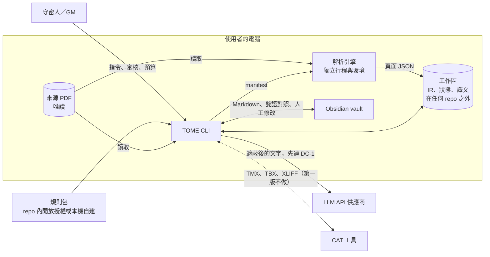
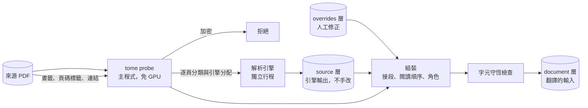
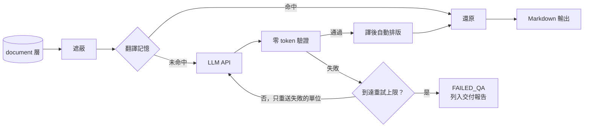
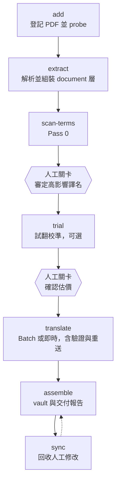
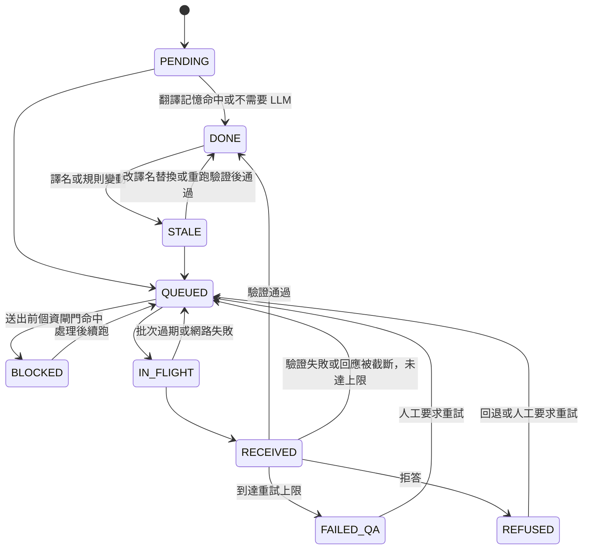

# TOME 架構白皮書

**TRPG Omnilingual Markdown Engine：把你自己擁有的 TRPG 書在本機解析，用你自己的 LLM 帳號翻成能直接上桌的繁體中文。**

| 文件控制 | |
| :--- | :--- |
| 版本 | 1.0.0 |
| 狀態 | 已定案。九輪討論已完成，決策見 [§9](#9-架構決策)。M0 的基礎已實作，M1 進行中，還沒有翻譯功能，之後的改動走 ADR |
| 日期 | 2026-11-01 |
| 結構 | [arc42](https://arc42.org) 範本加 [C4](https://c4model.com) 視圖 |
| 正式語言 | 繁體中文（ADR-0003）。README 另有英文版 |
| 決策紀錄 | `docs/adr/`，格式見 ADR-0021；[§9](#9-架構決策) 是索引 |
| 佐證資料 | [docs/research/2026-10-31-landscape.md](research/2026-10-31-landscape.md) |
| 需求用語 | MUST、MUST NOT、SHOULD、SHOULD NOT、MAY 全大寫時依 [BCP 14](https://www.rfc-editor.org/info/bcp14) 解讀 |
| 授權 | Apache-2.0（ADR-0002）。規則包各自帶授權 |

## 怎麼讀這份文件

每一項關於系統的主張都帶一個成熟度標籤。沒有標籤的主張算缺陷。

| 標籤 | 意思 | 需要的佐證 |
| :--- | :--- | :--- |
| **已實作** | 程式碼裡有，並由測試或可執行斷言檢查 | 原始碼路徑加測試 |
| **已定案** | 設計已寫死在本文件或 ADR，但還沒有程式碼 | 本文件的章節或 ADR |
| **目標** | 可量測的品質目標，有量測方法，**尚未量測** | [§10](#10-品質需求) 的條目 |
| **假說** | 架構倚賴的假設，必須先驗證 | [§11](#11-風險與假說) 的條目 |
| **提案** | 原則已定案，欄位名稱這類細節實作時可以調整 | 所在章節的說明 |

**這份文件裡的成本與品質數字，除了下面列出的實測，都不是實測。** 成本依公開價目推算，價目查證日是 2026-10-31。實測目前有這幾項：`node:sqlite` 的能力檢查（[佐證 §2.9](research/2026-10-31-landscape.md#29-nodesqlite-實測)）、憑證庫（[H-14](#11-風險與假說)）、規則包正則的限時（[H-16](#11-風險與假說)）、文字層品質判斷（[H-10](#11-風險與假說)），以及 `tome probe` 在合成書上的速度（[§10](#10-品質需求) 的 Q-9，真實書籍還沒量，所以仍是目標）。

文中的「輪」是設計討論的回合，見[附錄 B](#附錄-b討論順序與路線圖)。編號不重用，所以 TC、S、H 有跳號，那些項目已撤銷。ADR 裡的 prompt 指專案最初的需求說明，沒有公開，規格都以這份文件為準。「第一版」就是 0.1.0。

## 目錄

- [執行摘要](#執行摘要)
- [1. 介紹與目標](#1-介紹與目標)
- [2. 限制](#2-限制)
- [3. 系統脈絡與範圍](#3-系統脈絡與範圍)
- [4. 解法策略](#4-解法策略)
- [5. 建構區塊視圖](#5-建構區塊視圖)
- [6. 執行期視圖](#6-執行期視圖)
- [7. 部署視圖](#7-部署視圖)
- [8. 橫切概念](#8-橫切概念)
- [9. 架構決策](#9-架構決策)
- [10. 品質需求](#10-品質需求)
- [11. 風險與假說](#11-風險與假說)
- [12. 詞彙表](#12-詞彙表)
- [附錄 A：成本模型](#附錄-a成本模型)
- [附錄 B：討論順序與路線圖](#附錄-b討論順序與路線圖)

---

## 執行摘要

TOME 是在使用者自己電腦上執行的 CLI，把使用者擁有的 TRPG 書解析成結構化資料，用使用者自己的 LLM API 金鑰翻成繁體中文，輸出成能帶團使用的 Obsidian 相容 Markdown。專案不提供任何書籍內容，譯文也不得散布。

| 問題 | TOME 的做法 |
| :--- | :--- |
| 排版就是內容 | PDF 在本機解析成自訂的文件中介格式，規則書的雙欄、邊欄、表格都保留角色與座標 |
| 數字就是規則 | 骰子與公式先遮蔽再翻譯，翻完用不花 token 的驗證檢查，失敗只重送該段 |
| 譯名要一致 | 先抽出專有名詞，高影響的由人審定，再用翻譯記憶與驗證鎖住 |
| 指代靠上下文 | 實體卡記下性別與代名詞，最近提過的實體一起送給模型 |
| 成本難預測 | 本機估價，預算是必填的硬上限，預設用 Batch，中斷後已驗證的段落不重付 |
| 書是買來的 | PDF 不離開本機，個資送出前過閘門，公開 repo 只放開放授權內容 |

主程式是 TypeScript，Node 24 以上。解析引擎是獨立行程，預設用 Docling。遊戲系統是資料形式的規則包，第一版附 `generic` 與 `d100-orc`。第一版只接 Anthropic，路線見[附錄 B](#附錄-b討論順序與路線圖)。

這份摘要的內容都已定案，依據見 [§9](#9-架構決策) 的 ADR 索引。目前完成 M0 的基礎，M1 解析進行中，見[附錄 B](#路線圖)，還沒有翻譯功能。所有品質數字都是目標，量測狀況見 [§10](#10-品質需求)。

---

## 1. 介紹與目標

### 1.1 問題

TRPG 書的翻譯跟一般 PDF 翻譯不一樣，難處有六個：

1. **排版就是內容**：雙欄、邊欄、表格、數值塊。一般抽取會打亂閱讀順序，表格一散，規則就不能用了。
2. **數字就是規則**：`1D100`、`1/1D6`、`[CD]`。LLM 改動一個字元，譯文看起來沒問題，規則卻錯了。
3. **譯名要全書一致**：同一個 NPC、同一條規則在四百頁裡只能有一個名字。分塊並行翻譯時，譯名最容易分裂。
4. **指代靠上下文**：日文常省略主語，英文的 they 看不出性別；中文卻要選他、她、牠、它、祂。神祇用「祂」就是一例。
5. **內容偏恐怖與暴力**：供應商的內容過濾會把正常的恐怖題材擋下來，Batch 裡甚至會以「成功」的狀態回傳拒答。
6. **書是買來的**：檔案帶著購買者個資，不能進公開 repo，也不該送給會拿內容去訓練模型的服務。

現有工具（BabelDOC、PDFMathTranslate、bilingual_book_maker、Calibre Ebook Translator）解決的是論文版面或電子書雙語。查證時沒看到針對單一遊戲系統的規則包，也沒看到能辨識數值塊的佔位保護（[佐證 §3.5](research/2026-10-31-landscape.md#35-同類工具)）。

### 1.2 目標

| ID | 目標 | 成熟度 |
| :--- | :--- | :--- |
| G-1 | **上桌品質**：譯文可直接帶團使用，骰子與數值零錯誤，譯名全書一致，用語是台灣繁體中文 | 已定案（ADR-0066） |
| G-2 | **系統與語系可插拔**：遊戲規則與語言規則都是資料，引擎核心不含任何遊戲知識。目標語言只承諾 zh-TW | 已定案（ADR-0009、ADR-0023、ADR-0044） |
| G-3 | **先知道花多少，再花錢**：開跑前估價，試翻一小段，超過預算就停 | 已定案（ADR-0035、ADR-0081） |
| G-4 | **隨時可中斷**：任何步驟中斷都能續跑，已通過驗證的段落絕不重付 | 已定案（ADR-0054、ADR-0056） |
| G-5 | **合規是結構，不是紀律**：公開 repo 在架構上就裝不進商業書籍內容與個資 | 已定案（ADR-0039、ADR-0053） |
| G-6 | **不綁供應商**：能換供應商與模型。預設走 API，本機端點接得上但不承諾 | 已定案（ADR-0025、ADR-0032） |

### 1.3 非目標

* 不散布譯文，不提供任何書籍內容。
* 不繞過 DRM，不處理加密的 PDF。
* 不產出「乾淨版」PDF，來源檔永遠不修改。
* 不把 PDF 或頁面影像送到雲端。
* 不做線上服務。TOME 是在使用者自己電腦上執行的 CLI。
* 第一版不做重新排版。輸出是結構化文字，不是印刷成品。
* 第一版沒有圖形介面。審定與校稿走檔案和 Obsidian，核心寫成函式庫，之後要加本機介面不用重寫（ADR-0028）。

這份清單已定案（ADR-0020）。

### 1.4 使用者與貢獻者

| 角色 | 需要什麼 |
| :--- | :--- |
| 守密人／GM | 擁有原書，想要一份能帶團的中文版 |
| 規則包作者 | 不用懂引擎內部，用資料檔就能描述一套系統 |
| 引擎貢獻者 | 測試不需要任何商業書籍就能完整跑過 |

---

## 2. 限制

本章的限制都已定案，依據列在各表。

### 2.1 技術限制

| ID | 限制 | 依據 |
| :--- | :--- | :--- |
| TC-1 | 參考機器：Windows 11、Ryzen 7 7735HS（8C/16T）、32 GB RAM、RTX 4060 Laptop 8 GB VRAM。效能目標以它為準 | 2026-10-31 本機探測 |
| TC-2 | PDF 與頁面影像 MUST NOT 離開本機 | 需求 |
| TC-5 | 各家 token 數不可比較，切塊 MUST 用與供應商無關的計量，換供應商時段落 ID 才穩定 | [佐證 §1.1](research/2026-10-31-landscape.md#11-模型與價格) |
| TC-6 | 主程式用 TypeScript，執行環境是 Node 24 以上。解析引擎可以用任何語言；Docling 引擎是 Python，環境由 uv 管理 | ADR-0015、ADR-0052，[佐證 §2.8](research/2026-10-31-landscape.md#28-主程式語言選型) |

### 2.2 授權限制

| ID | 限制 | 依據 |
| :--- | :--- | :--- |
| LC-1 | 主程式在同一行程內的相依 MUST 限 MIT、Apache-2.0、BSD、ISC、MPL-2.0 | [佐證 §2.5](research/2026-10-31-landscape.md#25-授權陷阱) |
| LC-2 | AGPL、GPL、非商業、OpenRAIL 類引擎 MUST NOT 在主程式行程內匯入，也不隨附；只能由使用者自行安裝，以獨立行程溝通 | 同上 |
| LC-3 | 引擎的程式授權與權重授權分開審查。權重授權要留下紀錄，因為兩者常常不同 | 同上（Marker、MinerU、NDLOCR-Lite 都是例子） |

LC-1 到 LC-3 已定案（ADR-0016、ADR-0043）。常見的 PyMuPDF 是 AGPL-3.0，不符合 LC-1。主程式用 pdf.js（Apache-2.0）讀 PDF 結構，套件是 `unpdf`（MIT），它內含 pdf.js，沒有原生模組；官方的 `pdfjs-dist` 會把授權在白名單外的 `@napi-rs/canvas` 載入主程式行程，所以不用（ADR-0084）。Docling 引擎用自己的環境，內含 pypdfium2、RapidOCR 等寬鬆授權的元件。

LC-1 有一個明文例外：`@napi-rs/keyring` 的 Linux 二進位檔靜態連結 `libdbus`，TOME 依 AFL-2.1 使用，不重新散布二進位檔，已定案（ADR-0083）。

**已實作**：`tools/check-licenses.ts` 讀 `package-lock.json` 檢查全部相依的授權，沒審過的主程式原生套件也擋下，CI 的 `test` 工作流程執行它（`tests/tools/check-licenses.test.ts`）。開發相依多收 0BSD，`png-js` 2.0.0 有綁版本的例外，主程式的白名單不變（ADR-0084）。ADR-0016 的斷言擋下已知的 AGPL、GPL 與引擎套件進 `src/`。

### 2.3 出版社與著作權

下表是公開 repo 能不能附帶該系統規則包的查證結果。全文與來源見[佐證 §3.1](research/2026-10-31-landscape.md#31-出版社政策)。

| 系統 | 開放授權 | 對公開附帶規則包的影響 |
| :--- | :--- | :--- |
| Basic Roleplaying | **有**（ORC） | 可以，要附 ORC 聲明，並避開 Reserved Material。名稱是商標，規則包用中性 ID（ADR-0042） |
| GUMSHOE | **有**（SRD，CC BY 3.0） | 可以，要依格式署名；商標可用但 Logo 不行，不含任何具名設定 |
| Call of Cthulhu 7e | 無 | 粉絲政策排除可下載軟體，需商業授權；「Call of Cthulhu」是註冊商標 |
| Delta Green | 無 | 指南明列不允許 AI 內容、翻譯、可執行檔；名稱使用也有限制。**四款裡衝突最大** |
| Trail of Cthulhu | 無 | GUMSHOE SRD 不涵蓋；商標未授權 |
| Achtung! Cthulhu | 未找到 | 社群計畫排除軟體，授權層排除生成式 AI 內容 |

遊戲機制與單一術語本身不受著作權保護（美國 17 USC 102(b)、台灣 §10-1），所以問題主要不在著作權，而在商標、出版社政策與彼此的關係。這是判斷，不是法律意見。ADR-0001 已定案：公開 repo 只附開放授權的規則包。

| ID | 限制 | 成熟度 |
| :--- | :--- | :--- |
| PC-1 | 公開 repo MUST NOT 含有任何商業書籍的原文段落，包含規則包與測試資料 | 已定案（ADR-0001） |
| PC-2 | 每個測試素材 MUST 在來源清單登記授權與雜湊值，未登記的檔案讓 CI 失敗 | 已定案（ADR-0061） |
| PC-3 | 偵測到加密的 PDF 時 MUST 拒絕處理，包含只限制複製、不需密碼就能開啟的 PDF（台灣 §80-2、17 USC 1201） | 已定案（ADR-0018） |
| PC-4 | 來源 PDF MUST NOT 被修改，TOME 不輸出修改過的 PDF | 已定案（ADR-0017） |
| PC-5 | 文件 MUST 說明 TOME 是給使用者處理自己擁有的書，譯文不得散布 | 已定案（ADR-0081） |
| PC-6 | 公開 repo 的規則包 MUST 只含開放授權內容；品牌系統的規則包 MUST 留在使用者本機工作區，不進 repo | 已定案（ADR-0001） |

**浮水印的立場**。TOME 不把這件事稱為去浮水印。台灣著作權法 §80-1 禁止移除權利管理電子資訊，§96-1 有刑責，定義又包含足以確認「其授權之人」的資訊，購買者姓名是否屬於這個定義，查不到見解。美國 1202(c) 則明文排除使用者的個人識別資訊。所以 TOME 的做法是（ADR-0017）：

* 這個功能的定位是**個資過濾**，目的是不讓使用者的個資外流給 LLM 或進入輸出，不是去除版權保護。
* 來源 PDF 原封不動（PC-4），過濾只發生在送出網路之前的衍生文字。
* 書名、作者、版權頁等權利資訊保留在輸出的來源紀錄裡。
* 文件與 CLI 都不使用「去浮水印」的說法。

### 2.4 資料外送

| ID | 限制 | 依據 |
| :--- | :--- | :--- |
| DC-1 | 任何文字送出網路前 MUST 通過個資檢查閘門，比對使用者本機設定的姓名、Email、訂單號清單。Pass 0 與主翻譯都一樣：送出前掃描整批，命中就整批不送並停下，列出命中位置，有單位的標成 `BLOCKED`。使用者處理後續跑，處理方式見 [§6.2](#62-翻譯單位的狀態)。頁面雜訊裡的購買者資訊在解析時已過濾，這道閘門是最後一關 | ADR-0017、ADR-0081 |
| DC-2 | 條款允許拿內容訓練的端點（Gemini 免費層、DeepSeek）MUST 預設拒絕，使用者要在單書設定明確開啟。Gemini 看不出金鑰是免費或付費層，所以要使用者宣告付費層才放行 | ADR-0019，[佐證 §1.5](research/2026-10-31-landscape.md#15-資料使用) |
| DC-3 | 估價輸出 SHOULD 同時顯示資料保留期。Batch 在 Anthropic 保留 29 天、OpenAI 30 天，都不適用 ZDR。結果收回後，有刪除 API 的供應商 MUST 呼叫，沒有的要在估價時警告（ADR-0033、ADR-0081） | [佐證 §1.4](research/2026-10-31-landscape.md#14-batch-api) |

### 2.5 命名

| 項目 | 名稱 | 原因 | 成熟度 |
| :--- | :--- | :--- | :--- |
| npm 套件名 | `tome-trpg`，由 npm 組織管理 | npm 上的 `tome` 已被占用；`tome-trpg` 在 2026-10-31 未被占用 | 已定案（ADR-0006、ADR-0076） |
| GitHub | `tome-trpg/tome` | 專案不綁個人帳號，現在搬成本最低 | 已定案（ADR-0076） |
| 指令 | `tome`，另設別名 `tome-trpg` | JFrog 與 `@tomehq/cli` 都用 `tome`；有衝突時用別名 | 已定案（ADR-0006） |

---

## 3. 系統脈絡與範圍

### 3.1 系統脈絡（C4 第 1 層）



信任邊界有三條，都已定案（ADR-0007、ADR-0039、ADR-0044）：

* **本機與網路**：跨過這條線的只有通過個資閘門（DC-1）且完成遮蔽的文字，PDF 與頁面影像不會過線（TC-2）。
* **主程式與規則包**：規則包是不受信任的資料，不執行程式，碰不到金鑰。
* **主程式與解析引擎**：引擎是獨立行程，不繼承金鑰。第一版沒有網路沙箱，第三方引擎要使用者自己判斷能不能信任。

### 3.2 外部介面

| 介面 | 方向 | 交換內容 | 約束 | 成熟度 |
| :--- | :--- | :--- | :--- | :--- |
| 來源 PDF | 讀入 | 使用者自己擁有的檔案 | 不修改（PC-4），加密就拒絕（PC-3） | 已定案 |
| 解析引擎 | 子行程 | manifest 與頁面 JSON（[§5.3](#53-解析引擎協定)） | 執行時離線 | 已定案（ADR-0007） |
| 工作區 | 讀寫 | IR、狀態、本機規則包、譯文 | MUST 在任何 repo 之外，預設是機器本地目錄 | 已定案（ADR-0053） |
| LLM API | 送出、接收 | 遮蔽後的文字 | DC-1、DC-2、DC-3 | 已定案（ADR-0032、ADR-0039） |
| 本機端點 | 送出、接收 | 同上 | OpenAI 相容協定接得上，不測試也不承諾 | 已定案（ADR-0025） |
| Obsidian vault | 讀寫 | [§5.5](#55-輸出obsidian-vault) 的目錄結構，`tome sync` 讀回人工修改 | 譯文不得散布（PC-5） | 已定案（ADR-0005、ADR-0012） |
| CAT 工具 | 匯入、匯出 | TMX、TBX、XLIFF | 第一版不做，標記模型對齊 XLIFF，之後可加 | 已定案（ADR-0026） |

### 3.3 範圍

本表整理自 [§1.2](#12-目標) 與 [§1.3](#13-非目標)，成熟度依各條目。

| 在範圍內 | 不在範圍內 |
| :--- | :--- |
| 解析 PDF、產生 IR、人工修正解析結果 | 修改來源 PDF、輸出 PDF |
| 翻譯、驗證、估價、續跑 | 代管服務、帳號、譯文分享 |
| Obsidian 相容 Markdown 與雙語對照 | 重新排版成印刷成品 |
| 規則包與語言設定檔的載入 | 隨附任何商業書籍的內容 |

---

## 4. 解法策略

以下是這份設計的主要策略。S-1 到 S-14、S-16、S-17 都已定案（ADR-0001、ADR-0007、ADR-0026、ADR-0032、ADR-0036、ADR-0038、ADR-0060、ADR-0061）。

| ID | 策略 | 為什麼 | 輪次 |
| :--- | :--- | :--- | :--- |
| S-1 | **文件中介格式（Document IR）才是真實來源**。每個區塊有穩定 ID、頁碼、座標、角色、語言與出處；Markdown 只是輸出之一。已定案（ADR-0007） | Markdown 會丟失座標與區塊角色，之後要接 VTT、雙語對照、重新排版時都得重抽 | 2 |
| S-2 | **解析引擎是獨立行程的外掛**，各自有環境，以 JSON 溝通。已定案（ADR-0007） | 兩個獨立理由指向同一個設計：授權隔離（LC-2）與相依互斥（pillow、pypdfium2 裝不進同一環境） | 2 |
| S-3 | **先遮蔽，再翻譯，翻完再驗證**。骰子、頁碼參照、公式先換成佔位符，譯文回來再還原；驗證失敗只重送失敗的單位 | 只做事後檢查的話，發現錯誤還要重付一次。遮蔽讓 LLM 根本碰不到這些字元；事後檢查留著當保險。查到的同類工具對佔位符遺失幾乎不處理 | 3 |
| S-4 | **用文字標籤協定傳段落**（如 `<s id="12">`），不用 JSON schema | 各家 API 模型都能用；DeepSeek 不支援 schema；Anthropic 改 schema 會讓快取失效，拒答也可能不符 schema；中文引號也不用處理跳脫 | 3 |
| S-5 | **Pass 0 產出實體卡，不只是詞表**：譯名、性別、代名詞、語域、首次出現位置，再由人審核鎖定。先在本機挖候選詞，只送候選詞與少量上下文 | 解決 §1.1 第 4 點，日文來源尤其需要；不必為了詞表把全書送一次 | 3 |
| S-6 | **段落層級的翻譯記憶**，鍵是遮蔽後的文字加上該段實際命中的詞彙，不是整份詞庫 | 用整份詞庫的雜湊當鍵的話，改一個詞就讓全書失效；遮蔽後的鍵還能讓只差骰子的段落共用譯文 | 3 |
| S-7 | **只做三種連線協定**：Anthropic Messages、Gemini、OpenAI 相容（OpenRouter、DeepSeek 走這條，本機端點也接得上）。用官方 SDK，不用 LiteLLM | 差異化功能（Batch、顯式快取）正好是抽象層會漏的地方；LiteLLM 2026-03 又發生供應鏈事件 | 4 |
| S-8 | **省錢順序是模型 > Batch > 快取**，快取策略由估價器依實測命中率決定，不為了跨門檻灌水。詞庫只送命中的詞條 | [附錄 A](#附錄-a成本模型)：輸出費約占八成；快取命中率低於約 51% 時，開 1 小時快取反而比不開貴 | 4 |
| S-9 | **拒答是一等狀態**：獨立於 QA 失敗，先回退同供應商，跨供應商要明確設定 | Anthropic Batch 的拒答回傳 `succeeded`，不主動檢查就會把空結果當成功 | 4 |
| S-10 | **QA 加入術語與用語檢查**：命中的詞彙在譯文裡必須是鎖定譯名；用語檢查表抓中國大陸用語。已定案（ADR-0060） | 只查骰子、結構、長度還不夠，術語一致才是 TRPG 翻譯最常出錯的地方；這些檢查都不花 token | 7 |
| S-11 | **合成 PDF 鍛造**：用程式產生帶標準答案的雙欄、邊欄、直書、假名標音 PDF。已定案（ADR-0061） | 同時解決「不能放商業書測試」與「沒有日文直書的公開評測」兩個問題 | 7 |
| S-12 | **公開 repo 只放開放授權的規則包**，品牌系統走使用者本機規則包 | [§2.3](#23-出版社與著作權)，已定案（ADR-0001） | 1 |
| S-13 | **先用 PDF 自帶的結構，再用模型**。書籤、頁碼標籤、連結註記、tagged 結構都先讀。已定案（ADR-0007） | 不用 GPU，可靠度也高。Docling 文件只提到用書籤推標題層級，且預設關閉；印刷頁碼對應與「見 p.123」的連結都要靠這些資料 | 2 |
| S-14 | **字元守恆檢查**。原生文字層的每個字元都要落在某個區塊，或被標成頁面雜訊，否則該頁失敗。已定案（ADR-0007） | 不花 token 就能抓到引擎漏掉的邊欄；判斷解析品質不必等人工審閱 | 2 |
| S-16 | **改譯名不重翻**：鎖定譯名改動時直接替換翻譯記憶，再跑一次驗證 | 中文沒有詞形變化，替換就夠了，不花 token | 3 |
| S-17 | **風格依區塊角色**：規則文字同詞同譯，敘事與朗讀文字可以放開一點 | 規則要精確，帶團朗讀的文字要有氣氛，兩者的翻譯要求相反 | 3 |

---

## 5. 建構區塊視圖

本章涵蓋文件模型與解析、翻譯核心、供應商層與 System Pack。區塊角色、欄位與協定格式的**細節是提案**，第一版實作時可以調整，但原則已定案（ADR-0005、ADR-0007、ADR-0008、ADR-0009、ADR-0023）。

### 5.1 解析流程



`tome probe` 用 pdf.js 在主程式內執行，不載入模型。它輸出：

* 文件層級：是否加密、是否 tagged、書籤、頁碼標籤、連結註記、是否為跨頁攤開版型。
* 頁面層級：`native`、`scan`、`broken_text`、`image_only` 四類，以及該頁要交給哪個引擎。
* 環境層級：GPU 與 VRAM。

分配先看頁面類型，再依 GPU 與 VRAM 決定引擎用 GPU 或 CPU 執行（ADR-0024）。文件允許混用引擎，每頁都記錄來源引擎。0.1.0 只處理 `native` 頁，掃描、壞文字層與純圖片的頁面不翻，列入交付報告，不靜默跳過（ADR-0081）。

**已實作**：`tome add` 與 `tome probe`（`src/core/book.ts`、`src/core/probe.ts`；`tests/core/book.test.ts`、`tests/core/probe.test.ts`、`tests/cli/book.test.ts`）。只有 `src/core/pdf.ts` 碰 pdf.js（ADR-0084）。結果存在 `ir/probe.json`，格式是 `tome-probe/1`，含書籤標題，所以只留在工作區，訊息與 `--json` 只有數字。

頁面分類的做法是提案，數字要等本機語料量過才算定案（H-7、H-8、H-10）：看不見的文字（繪製模式 3、7）占九成以上時，有滿版圖算 `scan`，否則算 `image_only`，所以 OCR 過的掃描檔不會被當成原生頁；最大的單張圖蓋住六成以上且字元少於 40 個算 `scan`，掃描書蓋上一行購買者頁尾也一樣；U+FFFD、私有區與控制字元占 5% 以上算 `broken_text`；沒有字但有圖或大量向量圖形算 `image_only`；全空的頁算 `native`，沒有東西要翻。跨頁攤開的判斷是六成以上的頁面寬高比到 1.2。GPU 用 `nvidia-smi` 查，只認 NVIDIA，因為引擎要的是 CUDA。

對應錯但字元都合法的文字層，字元類別抓不到，所以再比頁面的字母分布與來源語言設定檔的餘弦相似度，字母少於 200 個的頁不判斷，低於 0.8 算 `broken_text`。不用常見字比對，因為索引頁與數值塊幾乎沒有常見字，會被誤判。這兩個數字也是提案。

頁面的引擎分配要等引擎協定完成。

### 5.2 Document IR

格式名稱是 `tome-ir/1`，有版本號與公開的 JSON Schema，並可遷移。IR 只存在工作區，不進 repo，因為它含有書籍內容（PC-1）。

**已實作**：schema 在 `schemas/tome-ir-1.schema.json`，驗證在 `src/core/schema.ts`，型別在 `src/core/ir.ts`（`tests/core/schema.test.ts`）。一個 JSON 檔是引擎寫的一頁（`layer: source`）或組裝好的全書（`layer: document`）。下表以外另有 `pdf_sha256`、`layer`；`source` 另有 `page`；`document` 另有 `page_map` 與 `sections`，`blocks` 陣列的順序就是閱讀順序。引擎只能填核心角色，`flow` 在 `document` 層才必填。欄位細節是提案，`overrides` 的格式 M1 才定。

**三層**

| 層 | 內容 | 規則 |
| :--- | :--- | :--- |
| `source` | 引擎輸出的頁面，依 PDF 雜湊、引擎、版本、設定雜湊存放 | 不可變。相同的鍵不重跑 |
| `overrides` | 人工修正：改角色、改順序、合併、拆分、略過、`redact` | 獨立檔案，重新解析後還在。對不到區塊的修正要回報，不能靜默丟棄 |
| `document` | 合併後的結果：閱讀順序、區塊角色、章節樹 | 可隨時由前兩層重建，是翻譯唯一的輸入 |

**識別**

| 名稱 | 組成 | 用途 |
| :--- | :--- | :--- |
| `block_id` | 起始的實體頁索引＋內容雜湊前綴，同頁重複時加序號，如 `p0123-3f9a1c` | 指向書裡的位置，也是 `overrides` 的鍵 |
| `unit_id` | `block_id`，表格儲存格再加列與欄，如 `p0123-3f9a1c-r2c1` | 指向一個翻譯單位 |
| `content_hash` | 正規化文字的 SHA-256，與頁碼無關 | 偵測內容有沒有變。翻譯記憶的鍵用遮蔽後的文字，見 [§5.6](#56-翻譯核心) |

`block_id` 不用流水號。閱讀順序一改，流水號會全部位移，`overrides` 就對不到了。順序另外存在 `document` 層。ID 只用拉丁字母、數字與連字號，可以直接當 Obsidian 的區塊識別碼。

**翻譯單位**是段落（ADR-0008）：一個段落、清單項、標題或表格儲存格各是一個單位。單位怎麼組成請求見 [§5.7](#57-供應商層)。代價是勘誤只改一句時要重翻整段，雙語對照也只對齊到段。

**區塊欄位**

| 欄位 | 意義 |
| :--- | :--- |
| `id`、`content_hash` | 見上 |
| `role` | 區塊角色，見下表 |
| `flow` | `main` 或 `aside`。邊欄走 `aside`，不打斷正文，跨過邊欄的段落仍要接起來 |
| `group` | 同一個邊欄或規則包宣告的群組裡的多個區塊 |
| `section` | 所屬章節路徑 |
| `spans` | 一筆以上的頁碼與座標，段落跨欄或跨頁時會有多筆 |
| `text`、`raw` | 正規化後與引擎原始的文字。`raw` 給字元守恆檢查與追查問題使用 |
| `runs` | 行內樣式與標記：粗體、斜體、小型大寫、`ruby`、連結目標 |
| `table` | 表格的列、欄、跨列跨欄與表頭，每格都是翻譯單位 |
| `lang`、`writing_mode` | BCP 47 語言標籤；`horizontal-tb` 或 `vertical-rl` |
| `provenance` | 引擎、版本、設定雜湊、信心值 |

文件層級另存 `page_map`：實體頁索引對印刷頁碼。兩者常常不同，而規則書裡的「見 p.123」寫的是印刷頁碼。

**核心角色**只描述文件結構（ADR-0023）：`title`、`heading`、`paragraph`、`list_item`、`table`、`sidebar`、`figure`、`caption`、`footnote`、`toc`、`index`、`credits`、`furniture`。`furniture` 是頁首、頁尾、頁碼與購買者資訊。

遊戲概念都由規則包宣告，例如數值塊、handout、守密人資訊、朗讀文字，全部帶命名空間，寫成 `<規則包 ID>:<角色>`，例如 `generic:stat_block`。子包繼承父包的角色，可以覆寫同名角色的設定。不是每套 TRPG 都有 GM，核心不能預設這些概念。`generic` 包提供最常見的幾種。引擎核心不認得這些角色，也要能原樣傳遞。

`lang`、`writing_mode`、`ruby` 在第一版就留好。第一版只用英文，日文進來時不必改格式。

`DoclingDocument` 不適合直接當 IR：它沒有邊欄或方框文字的標籤，`TextItem` 的成員也沒列字型與字級，而角色判斷正需要這些資訊（[佐證 §2.6](research/2026-10-31-landscape.md#26-docling-文件模型與-pdf-自帶結構)）。Docling 是 `tome-ir` 的輸入之一，由轉接器轉換。

**字元守恆檢查**（S-14）在 `document` 層產生前執行：用 pdf.js 取得原生文字層比對 `raw`，容許空白、連字與斷字差異。缺字超過門檻，該頁標成解析失敗，不進翻譯。門檻與假陽性見 H-8。頁面是掃描件時沒有文字層，這項檢查不適用。

### 5.3 解析引擎協定

引擎是外部指令，協定名稱 `tome-engine/1`。

| 面向 | 規格 |
| :--- | :--- |
| 描述 | 引擎目錄有 `engine.yaml`，寫明指令、環境建法、能處理的頁面類型與授權。`tome engine add <名稱或路徑>` 讀它 |
| 呼叫 | `<引擎指令> --manifest <路徑>` |
| 輸入 | 一個 JSON manifest：PDF 路徑、頁碼清單、輸出目錄、來源語言、引擎選項 |
| 輸出 | 每頁一個 `tome-ir/1` JSON；一份 `engine.json` 記錄這次執行的名稱、版本、程式授權、權重授權、設定雜湊（LC-3） |
| 角色 | 引擎只填核心角色，規則包宣告的角色由組裝步驟判定 |
| 進度 | stdout 是 JSONL 事件，stderr 是記錄 |
| 失敗 | 單頁失敗不中止整批，結果列在輸出裡，由 TOME 決定重試或換引擎 |
| 環境 | 每個引擎一個獨立環境與鎖定檔，放在工作區。Python 引擎用 uv，其他語言照 `engine.yaml` 的寫法 |
| 選擇 | 同一種頁面有多個引擎時，依 `tome.yaml` 的 `engines` 順序 |
| 權重 | 只在 `tome engine add` 時下載，這是對外出口模組之外唯一的例外（ADR-0081）。執行時 MUST 離線 |
| 授權 | 主程式 MUST NOT 依賴任何引擎套件。不符合 LC-1 的引擎由使用者自行安裝（LC-2） |

Docling 是預設引擎，走同一套協定，沒有特權。它的轉接器是 Python，主程式是 TypeScript，兩邊只靠 `tome-ir` 的 JSON Schema 溝通。它能配合的地方都查過：`convert()` 有 `page_range`，權重可用 `docling-tools models download` 預先下載，再以 `artifacts_path` 指定，遠端服務預設關閉。

**已知限制**：第一版沒有網路沙箱，「執行時離線」靠的是協定、環境變數與引擎審查，TOME 無法在技術上擋住惡意引擎。第一方引擎之外的引擎，使用者要自己判斷能不能信任。

### 5.4 語言設定檔

來源語言與目標語言都是資料檔，引擎核心 MUST NOT 依語言代碼分支。

| 設定檔 | 內容 | 第一版 |
| :--- | :--- | :--- |
| 來源 | 正規化、斷字還原、接段規則、直書與標音處理、Pass 0 提示 | `en`；`ja` 等語言之後加入 |
| 目標 | 標點規則、用語檢查表、代名詞集合（他、她、牠、它、祂）、風格指南 | 只有 `zh-TW`（ADR-0009） |

目標語言只測試與承諾 zh-TW。評測與 QA 的成本會隨語言數相乘，所以 G-2 的目標語言部分只保證「加語言時不必改架構」。

**已實作**：`languages/source/en.yaml`、`languages/target/zh-TW.yaml`，格式是 `tome-lang/1`（`schemas/tome-lang-1.schema.json`），載入在 `src/core/language.ts`（`tests/core/language.test.ts`），隨 npm 包發送（ADR-0084）。欄位是提案。來源設定檔的文字品質資料已接進 `tome probe`；正規化、斷字還原與接段的資料要到組裝步驟才用到；Pass 0 提示到 M3 才加。目標設定檔目前只有資料，風格指南要在 M2 接進提示前由維護者審過，用語檢查表留空，OpenCC 的片語表在 M2 接上。語言代碼只拿來組檔名，有斷言擋下核心依語言代碼分支。

### 5.5 輸出：Obsidian vault

主要輸出是 Obsidian 相容的 Markdown（ADR-0005），雙語對照檔一律另外輸出，給校對使用。VTT 等其他格式之後由 IR 轉出。

```text
<書名>/
├── 00-書目與來源.md    # 書名、作者、版權資訊、來源雜湊、不得散布的聲明（PC-5）
├── 00-交付報告.md      # 覆蓋率、失敗單位、未翻內容、花費（§5.6）
├── 01-<章名>.md        # 一章一檔
├── entities/           # 實體卡，連結的目標
├── assets/             # 從原書抽出的圖片
└── review/             # 雙語對照
```

| 來源 | Markdown 寫法 | 說明 |
| :--- | :--- | :--- |
| 章節資訊 | YAML frontmatter | Obsidian 不支援巢狀屬性，所以用扁平欄位 |
| 邊欄 | `> [!sidebar] 標題` | 未知類型會退回 `note`，所以自訂類型是安全的 |
| 規則包宣告的區塊 | `> [!stat-block] 名稱` | 類型由規則包定義，同上 |
| 沒翻成的段落 | `> [!untranslated]` 加原文 | `FAILED_QA`、`REFUSED` 的單位，帶團時看得出來，內容也不會不見（ADR-0081） |
| 「見 p.42」 | `[[03-技能#閃避\|（參見原書 p.42）]]` | 優先連到標題，連不到才連區塊；都解析不到就留純文字 `（參見原書 p.42）`（ADR-0022） |
| 原書頁面邊界 | `<!-- page: 42 -->` | 預覽看不到，用來對回實體書（ADR-0022） |
| 區塊回溯 | `^p0123-3f9a1c` | 只放在連結目標上，完整對應表放在 `review/`（ADR-0081） |

Obsidian 的限制要在輸出端處理：

* 區塊參照是 Obsidian 專屬語法，其他 Markdown 工具不支援，所以連結優先用標題。
* 連結目標含有 `#`、`|`、`^`、`:`、`%%`、`[[`、`]]` 時可能失效，檔名與連結 MUST 先清理。
* Obsidian 不支援連到引言、callout、表格的內部，所以「連到邊欄裡某一段」只能落在整個邊欄。

vault 可以直接修改（ADR-0012）。`tome sync` 比對上次輸出與目前的 vault，把改過的段落存成人工譯文，優先序最高，之後重新輸出也不會覆蓋。併段、拆段這類結構改動回收不了，列在交付報告裡。

### 5.6 翻譯核心

本節的原則已定案（ADR-0026、ADR-0029、ADR-0081）。標記名稱與欄位是提案，第一版實作時可以調整。



**傳給 LLM 的格式**

```text
<s id="12" role="paragraph">Roll <ph id="1" kind="dice"/> against <pc id="2" kind="bold">Spot Hidden</pc>.</s>
```

| 標記 | 方向 | 意義 |
| :--- | :--- | :--- |
| `<s>` | 雙向 | 一個翻譯單位。`id` 是請求內的短編號，由 TOME 對應回 `unit_id` |
| `<ph>` | 雙向 | 被遮蔽的內容，空元素，`kind` 告訴 LLM 這是什麼，對應 XLIFF 的 `ph` |
| `<pc>` | 雙向 | 成對的行內格式，可以隨語序移動，對應 XLIFF 的 `pc` |
| `<new-term>` | 回傳 | LLM 標出實體卡沒有的專有名詞 |
| `<flag>` | 回傳 | LLM 標出不可譯的內容，如文字謎題、藏頭、雙關 |

第一版不做 TMX、TBX、XLIFF 匯入匯出。標記模型對齊 XLIFF，之後要加不必改內部。

**請求組成**（執行模式見 [§5.7](#57-供應商層)）

* 同一個表格、邊欄或規則包宣告的群組，單位 MUST 在同一個請求，表頭一起送。重送失敗的單位或對半拆時，同組的其他單位當上下文帶上。
* 靜態前綴放語言規範、規則包與全書提要。
* 動態部分放上文、這批命中的實體卡，以及**活躍實體**：最近 5 個區塊出現過的實體卡也一起送，請求開頭的 He、It 才選得對他、祂。

**遮蔽**：規則全部來自規則包，引擎核心不含任何模式（G-2），骰子格式放在一律載入的 `generic` 包。實體卡標成 `keep_source` 的咒文、虛構語言、密碼線索在主翻譯時也走遮蔽，LLM 碰不到。全是佔位符的單位不送 LLM。被遮蔽的原文存在 `book.db` 的單位資料裡。

**驗證與重試**：全部不花 token。確定是錯誤的才重送，風格問題只列報告，因為重送要花錢，用語檢查也有誤報（ADR-0060）。

| 檢查 | 失敗時 |
| :--- | :--- |
| 段落編號一對一，沒有多也沒有少 | 重送 |
| 每個 `ph`、`pc` 恰好出現一次 | 重送 |
| 佔位符之外的數字守恆，只比阿拉伯數字，three 與「三」不算不同。單位不換算，吋、磅、貨幣都照原數字 | 重送 |
| 命中的詞條在譯文裡是鎖定譯名 | 重送 |
| 混入簡體字 | 重送 |
| 長度過短，疑似摘要，比例來自目標語言設定檔 | 重送 |
| 疑似大陸用語：OpenCC 台灣片語表加自訂清單 | 列報告 |
| 機翻腔訊號、長度過長、代名詞與實體卡不符 | 列報告 |
| 輸出的標題與表格結構跟 IR 不符 | 輸出失敗，這是程式錯誤 |

失敗時只重送失敗的單位並附上原因，預設最多 3 次。到達上限標成 `FAILED_QA`，列入交付報告，輸出時保留原文，MUST NOT 靜默略過。查到的 BabelDOC、PDFMathTranslate v1 都沒有這個保證（[佐證 §1.9](research/2026-10-31-landscape.md#19-標籤協定與佔位符的前例)）。

**譯後自動排版**：不花 token 修標點與空白，包含全形標點、引號改「」、數字與英文的間距。它在還原之前執行，佔位符不受影響，所以 `1D100` 不會被改成 `1 D100`。規則放在目標語言設定檔，這類問題不用重送 LLM。

**實體卡與 Pass 0**（S-5）

1. 本機挖候選詞：書的索引、標題、粗體、大寫片語、規則包。
2. 只把候選詞和幾段上下文送給便宜模型，上下文優先挑首次出現與帶代名詞的句子。同時從目錄與序章產出**全書提要**：時代、基調、主要勢力。
3. 模型提議譯名、類別、性別、代名詞、語域。類別由規則包宣告（ADR-0023）。
4. 依出現次數與類別分級審定：高影響的由人審，低頻的自動通過但保留紀錄。一本書可能有上千個候選詞，全部人審做不到。
5. 鎖定後才進主翻譯。主翻譯回報的 `<new-term>` 進入同一個審定佇列，這是 Pass 0 的安全網（H-11）。

實體卡另有兩個欄位：

* **比對條件**：大小寫、全字、限定角色。`Dodge` 命中技能，`dodge` 不算，否則譯名驗證會大量誤報。
* **`keep_source`**：保留原文，走遮蔽。

譯名用「提示＋驗證」，不做硬替換。優先序是：使用者 > 本書審定 > 系列 > 規則包 > LLM 提議。

`tome glossary import` 讀 CSV，把自己整理的官方譯名或舉團慣用詞放進本書的實體卡。**系列詞庫**讓同一個戰役或系列的多本書共用譯名與翻譯記憶，排到 0.1.0 之後。日文沒有大寫線索，候選詞的挖法到時再評估。

**翻譯記憶**（S-6）的鍵是：遮蔽後文字的雜湊、命中詞條摘要、目標語言、風格版本。風格版本是該角色風格文字的雜湊（ADR-0050）。短段落（預設 40 字元以下）再加前一段的雜湊，避免 `It moves.` 這種句子用錯它、牠、祂。模型不在鍵裡，存成中繼資料。翻譯記憶與人工譯文存在 `series.db`；每本書預設自成一個系列，所以 0.1.0 也用它，跨書共用排到之後。人工譯文的優先序最高（ADR-0012）。依內容雜湊只翻變動段落的新版更新，排到 0.1.0 之後。

**改譯名不重翻**（S-16）：鎖定譯名改動時，直接替換受影響的譯文，再跑一次驗證。替換要避開較長詞條的子字串。人工譯文不替換，內含舊譯名的段落列入交付報告，由人決定（ADR-0081）。代名詞或語域改動無法用字串替換，受影響的單位要重翻，會先列出估價。

**風格與校稿**：風格依區塊角色（S-17），哪些角色用哪種風格由規則包決定。預設翻一次加零 token 驗證。依角色開啟的 LLM 校稿（ADR-0013）排到 0.1.0 之後（ADR-0081）。

**交付報告**：每次輸出都產生一份，集中列出：

* 翻譯覆蓋率與花費
* `FAILED_QA`、`REFUSED`、`BLOCKED` 的單位
* 沒翻的頁面：解析失敗，以及掃描、壞文字層、純圖片的頁
* 沒翻的圖片
* 不可譯旗標，留給人手改或加譯註
* 只報告的檢查結果：疑似大陸用語、機翻腔、長度過長、代名詞
* `tome sync` 回收不了的結構改動，以及內含舊譯名的人工譯文
* 全書一致性問題：重複出現卻有多種譯法的片語。定案後用「改譯名不重翻」一次修掉

**不翻的內容**

| 內容 | 處理 | 決策 |
| :--- | :--- | :--- |
| 圖片裡的文字 | 第一版不翻，保留原圖，列在交付報告裡 | ADR-0010 |
| 索引 | 不翻，當 Pass 0 的候選詞來源 | ADR-0011 |
| 目錄 | 由標題重新產生 | ADR-0011 |
| 版權頁 | 保留原文，放進來源紀錄 | ADR-0011 |

**排到 0.1.0 之後**：簡中來源 `zh-Hans`，先用 opencc-js 預轉，再讓 LLM 修用語與文體（ADR-0030）。

### 5.7 供應商層

本節的原則已定案（ADR-0031 到 ADR-0033、ADR-0037、ADR-0038、ADR-0041、ADR-0081）。參數細節隨供應商改版，見[佐證 §1.10](research/2026-10-31-landscape.md#110-第-4-輪補充)。

**協定**

| 順序 | 協定 | 涵蓋 | SDK |
| :--- | :--- | :--- | :--- |
| 1 | Anthropic Messages | Anthropic | `@anthropic-ai/sdk` |
| 2 | OpenAI 相容 | OpenAI、OpenRouter、DeepSeek；本機端點接得上但不承諾（ADR-0025） | `openai` |
| 3 | Gemini | Gemini | `@google/genai` |

三個 SDK 都是 Apache-2.0。不用 LiteLLM 這類抽象層，Batch 與快取由各協定自己實作。

**轉接層介面**（提案，第一版實作時可以調整）

```ts
interface LLMProvider {
  readonly id: ProviderId;
  readonly capabilities: ProviderCapabilities; // 是否有 Batch、顯式快取、遠端刪除

  send(request: TranslationRequest): Promise<RequestResult>;

  submitBatch(requests: TranslationRequest[], intent: BatchIntent): Promise<RemoteBatch>;
  pollBatch(batch: RemoteBatch): Promise<BatchStatus>;
  collectBatch(batch: RemoteBatch): AsyncIterable<RequestResult>;
  deleteRemote(batch: RemoteBatch): Promise<void>;
}

interface RequestResult {
  requestId: RequestId;
  outcome: 'ok' | 'refused' | 'truncated' | 'error';
  units: UnitResult[]; // 從回應解析出的 <s>，拒答時是空的
  usage: Usage;        // 供應商以請求計費，帳本依字元數分攤到單位
  raw: unknown;        // 原始回應，存進 book.db
}
```

轉接層不自己連網，一律透過對外出口模組（[§8.2](#82-對外出口)）。

| 供應商 | 快取 | Batch |
| :--- | :--- | :--- |
| Anthropic | `cache_control`，1 小時 TTL 與預熱依實測決定 | Message Batches |
| OpenAI | 預設隱式快取 | Batch API |
| OpenRouter | 轉交原廠機制 | `/api/v1/batches` |
| DeepSeek | 自動快取 | 無，走即時佇列，建議排離峰 |
| Gemini | 隱式快取 | Batch API |

**模型**：TOME 不內建預設模型，因為便宜模型的品質還沒驗證（H-2），不該替使用者選，也不該在沒注意時花到貴的模型。`scanner_model`（Pass 0 用）與 `translator_model`（主翻譯用）在 `tome.yaml` 必填，可以依區塊角色覆寫，例如規則文字用便宜模型、敘事文字用好模型。同一個群組用第一個單位的角色決定模型。`fallback_model` 選填，拒答時改送。範本會列出建議組合，並註明還沒有盲評。

**思考**：主翻譯預設關閉。能關的模型就關，不能關的用低 effort，估價要計入思考成本。實測後再決定哪些角色值得開（H-13）。

**執行模式**

| 模式 | 用途 |
| :--- | :--- |
| `batch` | 預設。每章一批，超過供應商上限才拆，省 50% |
| `realtime` | 沒有 Batch 的供應商，或用 `--realtime` 想馬上看到結果。有 RPM／TPM 限流與指數退避，每個請求完成就寫入狀態庫 |

一個請求約 6,000 字元（約 2,000 token），帶約 800 字元上文。用字元數是因為各家 token 計法不同（TC-5）。同組單位不拆開（ADR-0029）。

三個層級要分清楚：**單位**是一段譯文，**請求**是一次 LLM 呼叫，含多個單位，**批次**是供應商的 Batch 工作，通常一章一個，含多個請求。

**Batch 流程**：送出、輪詢、收結果、驗證、刪除遠端資料。每批送出前檢查預算（[§8.1](#81-成本控制)）。收回結果後，有刪除 API 的供應商 MUST 呼叫，縮短保留窗口。狀態機與續跑見 [§6](#6-執行期視圖)。

**拒答**是獨立狀態 `REFUSED`，不算 QA 失敗（ADR-0038）。轉接層 MUST 檢查各家的拒答訊號，Anthropic Batch 回 `succeeded` 時也要看 `stop_reason`。

1. 請求被拒時對半拆，用原模型重送，找出有問題的單位，其他單位照常完成。
2. 被拒的單位有設 `fallback_model` 就改送。即時請求可用伺服器端回退，Batch 自己重送。
3. 跨供應商回退只在設定檔明列時才做，因為會多一家看到內容。
4. 都沒有路或都失敗，就維持 `REFUSED`，列入交付報告，輸出時保留原文。

### 5.8 System Pack 規格

本節的原則已定案（ADR-0042 到 ADR-0051）。`tome system init` 與 `gumshoe-srd` 排到 0.1.0 之後（ADR-0080）。欄位名稱是提案，第一版實作時可以調整。

**已實作**：`tome-pack/1` 的 schema 在 `schemas/tome-pack-1.schema.json`，涵蓋 `pack.yaml`、`roles.yaml`、`entities.yaml`、`glossary.yaml`、`syntax_patterns.yaml` 與 `tests/*.yaml`，驗證在 `src/core/schema.ts`（`tests/core/schema.test.ts`）。每個物件都拒絕未知欄位，所以規則包指定不了連線端點或金鑰。`tome system new`、`list`、`lint`、`test` 在 `src/core/pack.ts`、`src/core/pack-lint.ts`、`src/core/pack-test.ts`（`tests/core/pack.test.ts`、`tests/cli/system.test.ts`），正則在 `src/core/patterns.ts` 與 `src/core/pattern-worker.ts` 的 worker thread 裡執行（`tests/core/patterns.test.ts`）。內建規則包要到 M2 才有，目前用測試專用的合成包 `tests/fixtures/packs/sample-pack` 驗證，CI 也用建置結果跑它。

下面的細節是提案。`detect` 列的模式全部命中才算該角色，要「其一」就在正則裡寫分支。正則一律開 `g` 與 `u`，`flags` 只能再加 `i`、`m`、`s`。測試案例是 `id`、`text`，加上預期抓到的 `matches` 或預期的 `role`，`role: null` 表示不該判定出角色。`lint` 依序查非資料檔與連結、schema、`id` 與資料夾、繼承、模式、參照、代名詞；手寫的危險寫法檢查只是警告，用對抗輸入實跑超時才算失敗。`--public` 另查 `LICENSE`、`NOTICE`、必要聲明與至少一個測試案例，必要聲明的清單在 `src/core/pack-notices.json`，授權要是清單裡的 `Apache-2.0`、`ORC`、`CC-BY-3.0`（ADR-0048、ADR-0084）。規則包寫到組裝步驟的角色判定還沒接上。

**三層知識**

| 層 | 內容 | 位置 |
| :--- | :--- | :--- |
| 引擎核心與語言設定檔 | 文件結構、驗證機制；zh-TW 規範放目標語言設定檔 | 主程式 |
| 規則包 | 一套遊戲系統的角色、術語、模式與文風 | `systems/<id>/` |
| 系列與單書 | 實體卡、翻譯記憶、單書覆寫檔 | 工作區 |

規則包**只能是資料**（YAML 與 Markdown），不執行任何程式。

**目錄**

```text
systems/<id>/
├── pack.yaml              # 身分、版本、授權、繼承、支援的來源語言
├── roles.yaml             # 區塊角色：偵測條件、文風、校稿、數值塊欄位
├── entities.yaml          # 實體類別、預設代名詞、審定權重
├── glossary.yaml          # 核心術語，含多來源語言
├── syntax_patterns.yaml   # 遮蔽與偵測模式
├── persona_and_tone.md    # 文風與時代語境
├── few_shots.md           # 雙語範例
├── tests/                 # tome system test 的輸入與預期結果
├── LICENSE                # 規則包自己的授權
└── NOTICE                 # 署名與必要聲明
```

```yaml
# pack.yaml
schema: tome-pack/1
id: d100-orc
version: 0.1.0
extends: generic
license: ORC
source_langs: [en]
```

**繼承**用單一 `extends`，例如 `generic`、`d100-orc`、使用者本機的包依序往下，子包覆寫父包。`generic` 是隱含的根，沒寫 `extends` 就是繼承它。一本書只套一個規則包，要混合就寫一個小包繼承主包。譯名的優先序不變：使用者 > 本書審定 > 系列 > 規則包 > LLM 提議，規則包這一層依繼承鏈由子到父。

**內建規則包**

| ID | 內容 | 授權 | 必要聲明 |
| :--- | :--- | :--- | :--- |
| `generic` | 骰子格式、常見角色與實體類別 | Apache-2.0 | 無 |
| `d100-orc` | 依 Basic Roleplaying: Universal Game Engine 的 ORC 內容 | ORC License | ORC 聲明、署名、Reserved Material 聲明 |
| `gumshoe-srd`（0.1.0 之後） | 依 GUMSHOE SRD | CC BY 3.0 | 固定署名文字，並標明有更動 |

`d100-orc` 的目錄用 ORC 授權，不是 Apache-2.0：ORC 要求衍生部分以同樣條款授權，也不得附加其他條款。ORC 把多系統產品的衍生範圍限定在相關部分，所以獨立目錄就夠了。

「Basic Roleplaying」是 Chaosium 的商標，ORC 不授權商標，所以 ID 與套件中繼資料用中性名稱，來源在 `NOTICE` 裡依 ORC 的署名要求寫明。GUMSHOE SRD 准許在授權作品中使用該商標，但 Logo 不行，Trail of Cthulhu 等具名產品也不能放進衍生內容。所有內建包 MUST NOT 暗示官方背書（[佐證 §3.8](research/2026-10-31-landscape.md#38-開放授權規則包的義務)）。

公開規則包的雙語範例與譯名只用開放內容與合成文字，譯名自己定，不抄任何官方中文版的詞表（PC-1）。

**`tome system init`**（0.1.0 之後）從使用者自己的書產生本機規則包：

1. 本機統計：骰子格式、重複版面、高頻術語。
2. 抽樣幾十頁送 `scanner_model`，提議角色、術語與文風。受預算與個資閘門管制。
3. 產出草稿，放在工作區，由人審定後才能使用。

第一版不提供匯出。本機包可能含有商業書的文字，出版社政策規範的正是公開散布，所以 TOME 不幫忙做這件事。歡迎用 PR 貢獻只含開放內容的規則包，要通過 `tome system lint` 與 `tome system test`。`tome system new` 產生空白骨架，給想手寫規則包的人。

**來源**：內建包隨程式發佈，其他規則包放進工作區，同 ID 時本機優先。第一版沒有網路安裝。

**數值塊欄位化**：`roles.yaml` 可以宣告數值塊有哪些欄位。標籤用術語翻，數字直接保留；整塊都對得上就不送 LLM（H-15）。

**單書覆寫**寫在 `book.yaml`，調整這本書的年代、基調與額外模式，不用為了一本書另開規則包。實體類別可以設預設代名詞，例如神祇用祂，代名詞集合來自目標語言設定檔。

**安全**：規則包是不受信任的資料。

* 模式在 worker thread 執行並設時限，卡住就終止並回報是哪個模式（H-16）。
* `persona_and_tone.md` 會進入提示，使用別人的規則包前要自己看過。
* 規則包不能指定連線端點，也不能碰金鑰。

**工具**

| 指令 | 作用 |
| :--- | :--- |
| `tome system lint` | 檢查 schema、危險的正則寫法。公開包另查 `LICENSE`、必要聲明與署名，由 CI 把關，因為 ORC 的聲明寫漏會讓授權自動終止 |
| `tome system test` | 不花 token，驗證模式抓得到骰子與數值塊。公開包必備 |
| `tome glossary why <詞>` | 顯示這個譯名來自哪一層、哪個規則包 |

翻譯記憶的風格版本用該角色風格文字的雜湊，不用規則包版本號。改一個角色的文風，其他段落不用重翻。`tome probe` 可以依關鍵詞與骰子格式建議規則包，但只建議，`--system` 仍由使用者指定。

## 6. 執行期視圖

本章的原則已定案（ADR-0052 到 ADR-0059、ADR-0081）。狀態名稱、資料表與欄位是提案，第一版實作時可以調整。

### 6.1 流程



`tome run` 一路跑到下一個人工關卡，各階段指令也能單獨執行，兩者是同一套流程。要翻部分內容用 `--chapters`，例如 `tome run <book> --chapters 3`。它只限定翻譯與輸出；解析與 Pass 0 仍跑全書，譯名才會一致，所以這兩步的花費不會因此變少。範圍存進 `book.yaml`，之後的 `tome run` 沿用，直到改掉為止。

`--system`、`--source-lang` 在 `tome add` 時給，`--budget` 在第一次付費前給，都存進 `book.yaml`。試翻預設不跑，要跑就加 `--trial`。

兩個關卡都不能跳過：

* 鎖定譯名前審高影響的詞條，用 `tome glossary review <book>`。
* 主翻譯前確認估價，用 `tome estimate <book> --confirm`。

過關後再執行一次 `tome run` 就會接著跑。試翻後要不要停由使用者設定。Pass 0 與試翻也會花錢，它們在關卡之前，但都顯示自己的估價，並計入預算。

`translate` 包含驗證與重送。`tome verify` 用存下來的原始回應重跑驗證，不花 token，驗證規則改了就用它。

每個階段記下輸入的內容指紋，沒變就跳過，這同時是續跑的基礎。要花錢的重算會先列出單位數與估價。

**長時間的翻譯**在前景執行，沒有常駐服務。`tome translate` 送出批次並輪詢，Ctrl-C 不會遺失進度，批次仍在供應商那邊跑；之後再執行一次，或用 `tome batch collect` 收回。每本書同時只跑一個流程，由鎖檔保證。

**批次提交**先寫入意圖紀錄，再呼叫 API，取得遠端 ID 後才更新。當機時靠這份紀錄比對遠端批次，避免重複付費（H-17）。

### 6.2 翻譯單位的狀態



不需要 LLM 的單位包括全是佔位符的單位，以及整塊對上的數值塊。

個資閘門命中後有兩種處理：確實是個資，就在 `overrides` 用 `redact` 遮掉那段衍生文字；是誤判，例如 NPC 剛好同名，就加進 `book.yaml` 的例外清單。沒處理的 `BLOCKED` 單位輸出時不放原文，只放 `[!untranslated]` 與說明，否則個資會進入輸出。`REFUSED` 會先自動走回退，沒有路才停下。`BLOCKED`、`FAILED_QA` 與走完回退的 `REFUSED` 會停留到有人處理，`tome translate --retry-failed` 把它們放回佇列。`DONE` 裡的人工譯文不會變成 `STALE`。

有單位之後的階段狀態由單位推導，不另外存一份；`add`、`extract`、`scan-terms` 這些還沒有單位的階段記在 `stage`（ADR-0081）。

### 6.3 工作區

**已實作**：`tome init` 與路徑檢查（`src/core/workspace.ts`、`src/core/path-guard.ts`；`tests/core/workspace.test.ts`、`tests/core/path-guard.test.ts`），資料存取層與遷移（`src/core/store.ts`；`tests/core/store.test.ts`）。檢查會解開 junction 與 symlink。`tome.yaml` 第一行是 `schema: tome-workspace/1`（ADR-0082）。`book.yaml` 的格式是 `tome-book/1`（`schemas/tome-book-1.schema.json`），欄位是提案。`book.db` 目前有 `tome_meta` 與 `stage`，`series.db` 只有 `tome_meta`，下面其他的表到各階段才加。

正式支援 Windows 與 Linux，macOS 盡力而為，不測試（ADR-0081）。預設位置是機器本地目錄：Windows 是 `%LOCALAPPDATA%\tome`，Linux 是 `~/.local/share/tome`，macOS 是 `~/Library/Application Support/tome`，可以用 `TOME_HOME` 改。`tome init` MUST 拒絕 git repo 內的路徑，偵測到 OneDrive、Dropbox 這類同步資料夾時要警告，否則譯文與書的片段會被傳上雲端（G-5）。這讓 G-5 成為結構，而不只靠 `.gitignore`。Obsidian vault 用 `tome.yaml` 的 `vault_path` 指定，同樣要過這項檢查。

```text
<TOME_HOME>/
├── tome.yaml                  # 工作區設定，不放秘密
├── systems/                   # 本機規則包
├── engines/                   # 解析引擎的環境
├── series/<id>/series.db      # 系列共用的譯名與翻譯記憶
└── books/<slug>/
    ├── book.yaml              # PDF 路徑與雜湊、單書覆寫
    ├── book.db                # 狀態、帳本、外送紀錄、原始回應
    ├── ir/                    # source 層與 document 層
    └── overrides.yaml         # 人工修正
```

來源 PDF 不複製進工作區，只記路徑與雜湊，不多造一份商業書的副本。檔案搬走時用 `tome add` 重新指到同一個雜湊。

**`book.db` 的主要資料表**

| 表 | 內容 |
| :--- | :--- |
| `stage` | 各階段的內容指紋，以及還沒有單位的階段狀態 |
| `unit` | 翻譯單位：`unit_id`、內容雜湊、被遮蔽的原文、群組、角色、狀態、嘗試次數 |
| `entity` | 本書的實體卡與審定狀態 |
| `batch`、`batch_unit` | 批次意圖、遠端 ID、對應單位、遠端刪除時間 |
| `response` | LLM 原始回應，驗證規則改了可以免費重跑 |
| `ledger` | 每個請求的 `usage` 與花費，依字元數分攤到單位 |
| `egress` | 外送紀錄：內容雜湊、供應商、模型、大小、時間 |
| `issue` | 交付報告的項目：`FAILED_QA`、`REFUSED`、`BLOCKED`、不可譯旗標、用語疑慮、一致性問題 |
| `render` | 上次輸出的段落與 `block_id` 對應，給 `tome sync` 使用 |

`series.db` 放系列實體卡、翻譯記憶與人工譯文，每筆記下來自哪本書。每本書預設自成一個系列。

資料庫用內建的 `node:sqlite`，開 WAL，以 `user_version` 做單向遷移。外面包一層資料存取層，它還是 Release candidate，需要時能換（ADR-0052）。

**刪除**：`tome purge <book>` 刪整個 `books/<slug>/`、這本書在系列記憶的項目，並清掉遠端殘留的批次。不動 PDF 與 vault，加 `--vault` 才刪 vault 裡這本書的資料夾。不論加不加，執行前都列出清單要使用者確認。`tome backup` 匯出資料庫與實體卡，不含 PDF，備份檔由使用者自己放在安全的地方。

### 6.4 指令

```text
tome init                              建立工作區
tome doctor                            檢查 Node、uv、金鑰、引擎、工作區、價目表
tome provider list|test|auth           供應商與金鑰，存金鑰用 tome provider auth set
tome engine add|list|remove            解析引擎
tome system new|init|list|lint|test    規則包
tome glossary review|import|why <book> 實體卡與譯名
tome add <pdf>                         加入一本書並執行 probe
tome run <book>                        一路跑到下一個人工關卡
tome probe|extract|scan-terms <book>   各階段單獨執行
tome trial|estimate|translate <book>
tome verify|assemble <book>
tome batch status|collect|cancel <book>
tome sync <book>                       回收 vault 的修改
tome status|report <book>              進度與交付報告
tome backup|purge <book>               備份與刪除
```

| 慣例 | 內容 |
| :--- | :--- |
| 全域旗標 | `--system`、`--source-lang`、`--provider`、`--budget`、`--chapters`、`--trial`、`--realtime`、`--dry-run`、`--json` |
| 設定優先序 | 旗標 > 環境變數 > 單書 > 工作區。設定檔 MUST NOT 放秘密 |
| 結束碼 | 0 正常、1 有發現、2 結果不可信，跟 spec 工具一致 |
| 輸出 | 訊息是繁中（ADR-0027），`--json` 給機器讀 |
| 紀錄 | 紀錄檔 MUST NOT 含書本文字 |

`tome assemble` 偵測到未回收的 vault 修改就拒絕輸出，列出檔案，要求先跑 `tome sync`，人工譯文不會被覆蓋。

**已實作**：`tome init [--vault <路徑>]`、`tome doctor`、`tome provider auth set <供應商>`、`tome add <pdf> [--as <名稱>] [--system <規則包>] [--source-lang <語言>]`、`tome probe <書>`（`src/cli/`；`tests/cli/run.test.ts`、`tests/cli/book.test.ts`）。訊息集中在 `src/cli/messages/zh-TW.json`，`--json` 的外層是 `tome-cli/1`，全域旗標目前只有 `--json`、`--help`、`--version`。`<book>` 預設取 PDF 檔名，撞名回 1 要求 `--as`（ADR-0084）。`tome add` 的 `--source-lang`、`--system` 指到不存在的語言或規則包時回 2。`tome system new <ID>`、`tome system list`、`tome system lint <ID 或路徑> [--public]`、`tome system test <ID 或路徑>` 也已實作（`tests/cli/system.test.ts`）。各項結束碼見 ADR-0082，加密的 PDF 回 1，打不開或檔案被換掉回 2。其他指令還沒有。

---

## 7. 部署視圖

本章已定案（ADR-0069 到 ADR-0078）。

### 7.1 安裝

```bash
npm install -g tome-trpg
```

需要 Node 24 以上。uv 只在安裝解析引擎時需要，`tome doctor` 會指引。第一版不提供單一執行檔，Node 的這項功能還在開發中。

Docling 轉接器的原始碼與 `uv.lock` 隨 npm 包發送，`tome engine add docling` 用 uv 建環境。版本跟主程式一致，不用多維護 PyPI 的發佈流程。

### 7.2 Repo

專案放在 GitHub 組織 `tome-trpg`，repo 是 `tome-trpg/tome`。npm 組織也叫 `tome-trpg`，套件名維持不帶 scope 的 `tome-trpg`，`@tome-trpg/` 留給之後的函式庫與規則包。轉移與佔位版本 `tome-trpg@0.0.0` 都已完成。

```text
tome/
├── src/core/           主程式的核心函式庫
├── src/cli/            CLI，只是核心外面的一層
├── schemas/            tome-ir、tome-pack 等格式的公開 JSON Schema
├── languages/          語言設定檔
├── systems/            內建規則包，各自有授權
├── engines/docling/    Python 轉接器與 uv.lock
├── tests/              測試與合成 PDF 產生器
├── tools/              維護用工具
├── briefs/             spec-brief 的回合契約
├── docs/               白皮書、ADR、查證資料、評測結果
└── .github/            CI、發佈、Issue 範本
```

### 7.3 CI

| 工作流程 | 觸發 | 內容 |
| :--- | :--- | :--- |
| `specs` | push 到 `main` 與 PR | spec-guard、`prove`、`cites`、spec-graph、spec-brief、`premises`，Windows 與 Ubuntu。**已實作**：`.github/workflows/specs.yml` |
| 測試 | push 到 `main` 與 PR | 測試、`npm audit`、相依授權檢查、效能預算、`tome system lint` 與 `test`、測試素材清單檢查。**已實作**前五項：`.github/workflows/test.yml`，檔名是 `test`，`npm audit` 的門檻是 `moderate`（ADR-0082）。內建規則包到 M2 才有，`tome system lint` 與 `test` 目前查測試用的合成包。測試素材清單等第一個素材進 repo 才加 |
| 引擎 | 改到 `engines/` 或手動 | 安裝 Docling 跑合成 PDF |
| 變異 | 排程 | 六個關鍵模組 |
| 發佈 | `v*` 標籤或手動演練 | 見下節 |

Action 全部釘在 commit，簽出不保留 token，安裝用 `--ignore-scripts`。Dependabot 更新相依與 Action，有冷卻期：npm 的 patch 一週、minor 兩週、major 一個月，Action 一律一週，安全更新不等。

### 7.4 發佈

1. 維護者推 `v*` 標籤，標籤只有維護者能推。
2. 確認標籤指的 commit 在 `main` 上，標籤、`package.json`、`CHANGELOG.md` 三者一致。
3. 跑完測試與規格檢查，打包，列出內容並檢查大小，拒絕 PDF、資料庫與測試資料進入 npm 包。
4. 用 npm Trusted Publishing 執行 `npm stage publish`，版本進入暫存區，誰都裝不到。
5. 維護者用 2FA 執行 `npm stage approve`，版本才真的發佈。

repo 與 secrets 都沒有 npm token。Trusted Publisher 設定後要在 2 天內完成首次發佈，所以要等第一版才設。設定好之後把套件的發佈權限改成要求 2FA 並禁用 token。手動觸發的演練不花版本號，能先測打包；Trusted Publisher 設定後也能測 OIDC 交換。簽章與上傳要第一個真實標籤才驗證得到。

版本從 0.x 起步，1.0 前每個 minor 可以有破壞性變更，寫進 `CHANGELOG.md`。`tome-ir`、`tome-pack`、`tome-engine`、`--json` 各自有版本號，因為工作區資料與第三方規則包會跨版本。

### 7.5 治理

白皮書討論階段維持直接推送 `main`。從第一個實作回合起，程式走 PR，CI 通過後由代理人合併；ruleset 要求 PR 與 CI，第一個實作回合才打開。

Issue 與 PR 開放，不需要 CLA。範本明寫不得貼商業書的文字或譯文。

TOME 零遙測：沒有使用統計，也不自動檢查更新。對外連線只有設定的 LLM API，以及安裝解析引擎時的下載。

token 沒有 Administration 權限，下列設定要維護者在網頁上開：

| 設定 | 時機 |
| :--- | :--- |
| `v*` 標籤的 ruleset | 已完成 |
| 機密掃描與 push protection | 已完成 |
| 私下回報漏洞 | 已完成 |
| CodeQL 預設設定 | 已完成（2026-11-01） |
| Immutable releases | 第一版之前 |
| `main` 的 ruleset | 已完成（2026-11-01） |

---

## 8. 橫切概念

遮蔽與驗證見 [§5.6](#56-翻譯核心)。

### 8.1 成本控制

本節已定案（ADR-0035、ADR-0036、ADR-0040）。

**預算**是必填的硬上限，以書為單位累計，從第一筆付費呼叫就生效（ADR-0081）。Pass 0、試翻、重試、回退全部計入。

* 每次送出前檢查：已花 + 進行中的估價 + 這次的估價 ≤ 預算，估價都取區間上限。Batch 是每批檢查，即時模式是每個請求檢查。
* 這是送出前的上限。花費要到回應才知道，實際花費可能略超過估價，所以供應商後台的花費上限仍是第二道保險。
* 超過就不送，流程停下並保留進度，已送出的批次會繼續跑完，要提早停用 `tome batch cancel`。
* 用 `--budget` 提高上限後續跑。

**估價**在本機完成，不連網：依字元數與各家比例估算，顯示成區間。`tome trial` 先翻一小段，用實際 `usage` 校準比例，人工改動也回饋成風格範例。試翻用小批次執行，才量得到 Batch 的快取命中率。估價同時顯示資料保留時間（DC-3）。

**快取**依實測決定。靜態前綴一律保持位元組一致，但不為了門檻灌水，詞庫只送命中的詞條與活躍實體。試翻量到的命中率高於損益兩平點，才開 1 小時快取與預熱。Gemini 預設走隱式快取。

| 工具 | 作用 |
| :--- | :--- |
| `--dry-run` | 組出所有請求但不送出，檢查個資閘門、前綴穩定度與估價 |
| 價目表資料檔 | 帶生效日與查證日，過期就警告 |
| 費用帳本 | 每個單位記下實際 `usage` 與花費，對照估價誤差，寫進交付報告 |
| 快取失效警報 | 開了快取卻連續沒命中就停下來警告 |

文件要建議使用者：在供應商後台也設花費上限，當第二道保險；TOME 用專用的 API 金鑰，出事時只撤這一把；用 DeepSeek 時排在離峰。

### 8.2 對外出口

本節已定案（ADR-0039）。

主程式所有對外網路請求 MUST 走單一模組，其他程式不得自己連網，由 spec-guard 斷言把關。唯一的例外是安裝解析引擎時由 uv 與引擎工具做的下載，那是獨立行程，使用者主動執行（ADR-0081）。個資閘門（DC-1）與端點白名單（DC-2）都在這裡。

**已實作**：ADR-0039 的兩條斷言擋下 `src/core/egress/` 以外的連網模組、供應商 SDK 與全域連網 API，`spec-guard prove` 看過它們失敗。M0 完全不連網，這個模組要到 M2 才建立（ADR-0082）。

本機留外送紀錄，只記內容雜湊、供應商、模型、大小與時間，不記內容。OpenRouter 一律送 `data_collection: deny`，因為它的預設是 `allow`。

### 8.3 金鑰

本節已定案（ADR-0034）。

`tome provider auth set` 把金鑰存進作業系統憑證庫（ADR-0081）。環境變數 `TOME_ANTHROPIC_API_KEY` 可以覆蓋，給沒有憑證庫的環境使用（ADR-0082）。Windows 的憑證庫實測可行（H-14）。Linux 釘在 Secret Service，沒有時回報憑證庫不可用，改用環境變數，不退回重開機就消失的 keyutils（ADR-0083）。

不論哪種方式，引擎子行程 MUST NOT 繼承金鑰，金鑰也 MUST NOT 出現在紀錄與報告裡。

**已實作**：`src/core/secrets.ts`、`src/core/process.ts`（`tests/core/secrets.test.ts`、`tests/core/doctor.test.ts`）。金鑰只從隱藏輸入或 stdin 讀，沒有旗標參數。子行程一律走 `src/core/process.ts`，環境變數先過濾，由 ADR-0082 的斷言把關。

### 8.4 測試

本節已定案（ADR-0061 到 ADR-0064、ADR-0067）。

| 層級 | 內容 | 執行時機 |
| :--- | :--- | :--- |
| 單元與性質 | vitest；fast-check 驗證遮蔽再還原一定回到原樣，狀態機用 model-based 測試 | 每次 CI |
| 整合 | 假供應商：本機伺服器說三種協定，腳本化拒答、漏佔位符、批次過期、429 | 每次 CI |
| 端到端 | 合成 PDF 配錄好的引擎輸出，從解析跑到 vault | 每次 CI |
| 當機注入 | 在狀態機每一步強制中斷再續跑，驗證沒有單位重付 | 每次 CI |
| 引擎 | 安裝 Docling 跑合成 PDF | 改到 `engines/` 或手動觸發 |
| 變異 | Stryker 跑遮蔽還原、驗證、翻譯記憶鍵、預算、對外出口、狀態機六個模組 | 排程 |
| 契約 | 真 API 小額跑，防止假供應商跟現實脫節 | 幾個月手動一次 |

CI 跑 Windows 與 Ubuntu。公開 repo 的 CI MUST NOT 放任何 API 金鑰。變異分數的門檻等第一次實測後再定。

**已實作**：單元與性質測試在 `tests/`，用 vitest 與 fast-check，`.github/workflows/test.yml` 在兩個平台都跑。Q-9 的效能預算是 `tests/perf/probe-budget.test.ts`，CI 門檻 120 秒。其他層級等對應的功能完成才加。

### 8.5 測試語料

本節已定案（ADR-0061）。

| 語料 | 內容 | 位置 |
| :--- | :--- | :--- |
| 合成 PDF | 測試時產生，帶標準答案 | 不進 repo，產生器在 repo |
| 公開素材 | BRP ORC 文件、GUMSHOE SRD、公有領域的 Lovecraft 作品 | 下載後驗證雜湊，不進 repo |
| 本機私有 | 使用者自己的商業書 | 只在本機，結果不公開 |

repo 裡 MUST NOT 有任何 PDF。每個測試素材 MUST 在來源清單登記授權與雜湊值，未登記的讓 CI 失敗（PC-2）。

**合成 PDF 鍛造**（S-11）只用 `pdfkit`，它是開發相依，底層物件用它的低階介面補。`pdf-lib` 五年沒有更新，又帶進白名單外的授權，所以不用（ADR-0084）。案例有雙欄、跨欄邊欄、跨頁表格、首字放大、標題轉外框、背景紋理、頁尾購買者浮水印、連字、斷字、壞掉的 ToUnicode、隱藏文字、書籤、頁碼標籤、連結。直書與假名標音在日文階段才加。驗證基準一律用生成時的標準答案。

**已實作**：鍛造器在 `tests/forge/`（`tests/forge/forge.test.ts`），同一個案例每次產生同樣的位元組，加密案例除外。目前的案例是頁面分類與文件結構用的：純文字、書籤與頁碼標籤與連結、掃描頁、純圖片、壞 ToUnicode、隱藏文字、跨頁攤開、兩種加密、大本效能書。版面案例跟 document 層一起做。頁碼標籤與壞 ToUnicode 都做得出來（ADR-0061 的待驗證項）。

### 8.6 評測

本節已定案（ADR-0065、ADR-0068）。

模型品質由維護者親自盲評。約 100 段涵蓋各角色的黃金段落，先用自動指標淘汰，剩下的隨機排序、隱藏模型名稱，評 1 到 5 分。花費上限 30 美元，實作時先用 `--dry-run` 估準。

M4 只有 Anthropic，所以這次比較 Anthropic 的模型，並涵蓋思考開關（H-13）與指令語言（H-18），Q-8 也用這組黃金段落判定。跨供應商的比較（H-2、H-4）要等 OpenAI 相容協定完成。

公開語料的評測結果放 `docs/evals/`，範本不內建預設模型，使用者靠這份資料選模型。商業書的結果不公開。

### 8.7 可重現性

本節已定案（ADR-0067）。

每筆譯文記下提示雜湊、規則包雜湊、模型與 SDK 版本，查得到一段譯文怎麼來的。改提示或風格時，用黃金段落小額重跑並列出差異。

---

## 9. 架構決策

決策全文在 `docs/adr/`，這裡是索引。格式見 ADR-0021。

### 9.1 已定案

| ADR | 決策 | 輪次 |
| :--- | :--- | :--- |
| [ADR-0001](adr/0001-public-packs-open-license.md) | 公開 repo 只附開放授權的規則包 | 1 |
| [ADR-0002](adr/0002-license-apache-2.md) | 專案授權 Apache-2.0 | 1 |
| [ADR-0003](adr/0003-whitepaper-language.md) | 白皮書以繁體中文為準 | 1 |
| [ADR-0004](adr/0004-first-slice-english-native-pdf.md) | 第一版是英文原生 PDF | 1 |
| [ADR-0005](adr/0005-obsidian-markdown-output.md) | 主要輸出是 Obsidian 相容的 Markdown | 2 |
| [ADR-0006](adr/0006-naming.md) | 套件與指令命名 | 3 |
| [ADR-0007](adr/0007-document-ir-and-engines.md) | 自訂 tome-ir，解析引擎是獨立行程外掛 | 2 |
| [ADR-0008](adr/0008-translation-unit-paragraph.md) | 翻譯單位是段落 | 2 |
| [ADR-0009](adr/0009-target-language-data.md) | 目標語言規則放資料檔，只承諾 zh-TW | 2 |
| [ADR-0010](adr/0010-image-text-not-translated.md) | 圖片裡的文字第一版不翻 | 3 |
| [ADR-0011](adr/0011-index-toc-credits.md) | 索引、目錄、版權頁的處理 | 3 |
| [ADR-0012](adr/0012-tome-sync.md) | vault 可直接修改，tome sync 回收 | 3 |
| [ADR-0013](adr/0013-single-pass-role-based-review.md) | 預設單次翻譯，校稿依角色開啟 | 3 |
| [ADR-0014](adr/0014-adopt-spec-tools.md) | 採用 spec 工具 | 3 |
| [ADR-0015](adr/0015-typescript-main-program.md) | 主程式用 TypeScript | 3 |
| [ADR-0016](adr/0016-dependency-license-policy.md) | 相依授權政策 | 3 |
| [ADR-0017](adr/0017-pii-shielding.md) | 購買者浮水印定位成個資遮蔽 | 3 |
| [ADR-0018](adr/0018-refuse-encrypted-pdf.md) | 加密的 PDF 一律拒絕 | 3 |
| [ADR-0019](adr/0019-deny-training-endpoints.md) | 預設拒絕會拿內容訓練的端點 | 3 |
| [ADR-0020](adr/0020-non-goals.md) | 確認非目標清單 | 3 |
| [ADR-0021](adr/0021-document-conventions.md) | 文件慣例 | 3 |
| [ADR-0022](adr/0022-page-references.md) | 原書頁碼參照 | 3 |
| [ADR-0023](adr/0023-core-roles-are-structural.md) | 核心角色只描述文件結構 | 3 |
| [ADR-0024](adr/0024-hardware-aware-routing.md) | 分配先看頁面類型，再看硬體 | 3 |
| [ADR-0025](adr/0025-api-first-local-unpromised.md) | 預設只走 API，本機模型不承諾 | 3 |
| [ADR-0026](adr/0026-translation-core.md) | 翻譯核心 | 3 |
| [ADR-0027](adr/0027-cli-language.md) | CLI 用繁中訊息 | 3 |
| [ADR-0028](adr/0028-cli-first-library-core.md) | 第一版只做 CLI，核心寫成函式庫 | 3 |
| [ADR-0029](adr/0029-translation-core-additions.md) | 翻譯核心的補充項目 | 3 |
| [ADR-0030](adr/0030-cross-round-recommendations.md) | 排到之後的項目 | 3 |
| [ADR-0031](adr/0031-provider-order.md) | 供應商實作順序 | 4 |
| [ADR-0032](adr/0032-official-sdks.md) | 用官方 SDK，不用抽象層 | 4 |
| [ADR-0033](adr/0033-batch-by-default.md) | 預設 Batch，收完刪除遠端資料 | 4 |
| [ADR-0034](adr/0034-api-key-storage.md) | API 金鑰存放 | 4 |
| [ADR-0035](adr/0035-hard-budget-and-estimate.md) | 預算硬上限與本機估價 | 4 |
| [ADR-0036](adr/0036-cache-policy.md) | 快取依實測決定 | 4 |
| [ADR-0037](adr/0037-thinking-off-by-default.md) | 主翻譯預設關閉思考 | 4 |
| [ADR-0038](adr/0038-refusal-state.md) | 拒答是獨立狀態 | 4 |
| [ADR-0039](adr/0039-single-egress.md) | 對外請求走單一模組 | 4 |
| [ADR-0040](adr/0040-cost-tooling.md) | 成本工具 | 4 |
| [ADR-0041](adr/0041-model-config-no-default.md) | 不內建預設模型 | 4 |
| [ADR-0042](adr/0042-neutral-orc-pack-name.md) | ORC 規則包改用中性名稱 d100-orc | 5 |
| [ADR-0043](adr/0043-allow-isc-license.md) | 相依授權白名單加入 ISC | 5 |
| [ADR-0044](adr/0044-packs-are-data-only.md) | 規則包只能是資料 | 5 |
| [ADR-0045](adr/0045-pack-inheritance.md) | 規則包單一繼承，一本書一個包 | 5 |
| [ADR-0046](adr/0046-pack-sources.md) | 規則包只來自內建與工作區 | 5 |
| [ADR-0047](adr/0047-system-init.md) | tome system init 用本機統計加抽樣 LLM | 5 |
| [ADR-0048](adr/0048-public-pack-content.md) | 公開規則包的內容與授權 | 5 |
| [ADR-0049](adr/0049-pack-regex-safety.md) | 規則包正則的防護 | 5 |
| [ADR-0050](adr/0050-pack-tooling.md) | 規則包工具 | 5 |
| [ADR-0051](adr/0051-pack-features.md) | 規則包的功能補充 | 5 |
| [ADR-0052](adr/0052-node-sqlite.md) | 狀態庫用 node:sqlite，最低 Node 24 | 6 |
| [ADR-0053](adr/0053-workspace-layout.md) | 工作區的位置與版面 | 6 |
| [ADR-0054](adr/0054-foreground-resumable-execution.md) | 前景執行，可中斷續跑 | 6 |
| [ADR-0055](adr/0055-cli-structure.md) | 指令結構與人工關卡 | 6 |
| [ADR-0056](adr/0056-content-fingerprints.md) | 依內容指紋重算 | 6 |
| [ADR-0057](adr/0057-assemble-refuses-unsynced.md) | 有未回收修改時拒絕輸出 | 6 |
| [ADR-0058](adr/0058-local-data-retention.md) | 本機資料的保留與刪除 | 6 |
| [ADR-0059](adr/0059-cli-conventions.md) | CLI 慣例 | 6 |
| [ADR-0060](adr/0060-qa-severity.md) | 驗證分級與用語檢查 | 7 |
| [ADR-0061](adr/0061-test-corpus-and-forge.md) | 測試語料與合成 PDF 鍛造 | 7 |
| [ADR-0062](adr/0062-test-strategy.md) | 測試策略 | 7 |
| [ADR-0063](adr/0063-mutation-testing.md) | 關鍵模組的變異測試 | 7 |
| [ADR-0064](adr/0064-engine-ci.md) | 引擎測試走獨立工作流程 | 7 |
| [ADR-0065](adr/0065-blind-evaluation.md) | 模型品質由維護者盲評 | 7 |
| [ADR-0066](adr/0066-quality-targets.md) | 品質目標與第一版完成條件 | 7 |
| [ADR-0067](adr/0067-test-additions.md) | 測試補充項目 | 7 |
| [ADR-0068](adr/0068-process-additions.md) | 流程補充項目 | 7 |
| [ADR-0069](adr/0069-release-flow.md) | 發佈流程：標籤、暫存、2FA 核准 | 8 |
| [ADR-0070](adr/0070-reserve-npm-name.md) | 用佔位版本保留 npm 名稱 | 8 |
| [ADR-0071](adr/0071-install-and-engine-delivery.md) | 安裝方式與引擎發送 | 8 |
| [ADR-0072](adr/0072-merge-policy.md) | 合併規則 | 8 |
| [ADR-0073](adr/0073-versioning.md) | 版本策略 | 8 |
| [ADR-0074](adr/0074-zero-telemetry.md) | 零遙測 | 8 |
| [ADR-0075](adr/0075-contributions.md) | 開放貢獻，嚴禁貼書籍內容 | 8 |
| [ADR-0076](adr/0076-github-and-npm-organizations.md) | 專案放在組織底下 | 8 |
| [ADR-0077](adr/0077-dependency-updates.md) | 相依更新有冷卻期 | 8 |
| [ADR-0078](adr/0078-repository-security-settings.md) | repo 的安全設定與文件 | 8 |
| [ADR-0079](adr/0079-drop-old-translation-baseline.md) | 盲評門檻不再跟舊譯文比較 | 8 |
| [ADR-0080](adr/0080-roadmap-and-first-version-scope.md) | 路線圖與第一版範圍 | 9 |
| [ADR-0081](adr/0081-reader-test-corrections.md) | 讀者測試後的修正 | 9 |
| [ADR-0082](adr/0082-m0-toolchain-and-conventions.md) | M0 的工具鏈與 CLI 慣例 | M0 |
| [ADR-0083](adr/0083-keyring-native-license-exception.md) | 憑證庫原生模組的授權例外 | M0 |
| [ADR-0084](adr/0084-m1-parsing-decisions.md) | M1 解析的選型與範圍 | M1 |

---

## 10. 品質需求

下表全部是**目標**（ADR-0066）。Q-4、Q-5、Q-6、Q-9 的數字是初值，第一次實測後可能調整。除了下面註明的 Q-9，其他都還沒量測。

| ID | 目標 | 門檻 | 量測方法 | 對應 |
| :--- | :--- | :--- | :--- | :--- |
| Q-1 | 骰子與數字錯誤 | 0 | 驗證器加人工抽查 | G-1 |
| Q-2 | 鎖定譯名違規 | 0 | 驗證器 | G-1 |
| Q-3 | 簡體字殘留 | 0 | 驗證器 | G-1 |
| Q-4 | 原生頁通過字元守恆 | 99.5% 以上 | 合成 PDF 與本機語料 | H-8 |
| Q-5 | 閱讀順序正確 | 98% 以上 | 合成 PDF 的標準答案 | H-5 |
| Q-6 | 試翻校準後的估價誤差 | ±20% 內 | 費用帳本 | G-3 |
| Q-7 | 當機後已驗證單位重付 | 0 | 當機注入測試 | G-4、H-17 |
| Q-8 | 盲評分數 | 平均 4 分以上 | 維護者盲評（ADR-0079） | G-1 |
| Q-9 | 400 頁 `tome probe` | 參考機器 30 秒內 | 在參考機器實測。CI 另設較寬的門檻防止變慢 | ADR-0068 |

**Q-9 的第一次量測**（2026-11-01，參考機器，Node 24.22.1）：`tome add` 含探測與行程啟動，合成的 400 頁雙欄文字書 0.6 MB，三次都約 2.2 秒；合成的 1,200 頁書，其中 400 頁帶滿版圖，313 MB，約 14 秒。合成書的字型與圖片都比商業書單純，真實書籍還沒量過，所以 Q-9 仍是目標。

**第一版的完成條件**：公開的 ORC 文件一章，加本機商業書一章，全流程跑完，Q-1 到 Q-8 達標。

---

## 11. 風險與假說

每條假說都對應下表的驗證方式，沒驗證前，依賴它的功能不能標成已實作（ADR-0068）。

| ID | 假說 | 為什麼重要 | 怎麼驗證 |
| :--- | :--- | :--- | :--- |
| H-1 | Anthropic Batch 搭 1 小時快取與同步預熱，命中率能穩定超過 51% | 低於這條線，開快取比不開貴 | 用公開素材各跑一批，讀 `usage` |
| H-2 | 便宜模型（Haiku 5.5、gpt-6-luna、Flash-Lite）的 zh-TW 品質足以上桌 | 模型選擇是最大的成本槓桿，差距達百倍 | 同一段素材跨模型盲評 |
| H-4 | 恐怖題材的拒答率低到可以用回退處理 | 決定是否需要多供應商才能跑完一本書 | 用公有領域的 Lovecraft 文本測各家拒答率 |
| H-5 | Docling 加自製規則處得好雙欄、邊欄、數值塊 | 解析錯了，翻譯再好也沒用 | 合成 PDF 鍛造 + 本機私有語料 |
| H-6 | 字級與位移規則足以處理原生日文 PDF 的假名標音 | 沒有現成函式庫 | 合成 PDF 鍛造 |
| H-7 | 目標書籍多半帶書籤與頁碼標籤 | 沒有的話，章節層級與印刷頁碼要改從版面推斷，「見 p.123」的連結會變差 | 本機私有語料統計；`tome probe` 回報覆蓋率。回報已實作（`tests/core/probe.test.ts`），這台機器沒有商業書，統計**還沒做** |
| H-8 | 字元守恆檢查的假陽性夠低，不會把好頁面擋下來 | 隱藏文字、可選內容圖層、疊印的重複文字都可能造成差異 | 合成 PDF 鍛造 + 本機私有語料，再決定門檻 |
| H-9 | 內容雜湊夠穩定，換引擎後翻譯記憶仍命中 | 引擎對空白、連字、斷字的處理不同，正規化不夠就白付一次 | 同一份公開素材用兩個引擎解析，比對遮蔽後雜湊的重合率 |
| H-10 | pdf.js 足以判定文字層品質並做字元守恆 | 查到 PDFium 有 `FPDFText_HasUnicodeMapError`，pdf.js 這邊還沒找到對應訊號 | 合成 PDF 鍛造，故意做壞 ToUnicode；不夠時把深度檢查放進引擎。**文字層品質的部分已驗證**：2026-11-01 pdf.js 忠實回傳壞掉的 ToUnicode，映到私有區、U+FFFD 或半數字元壞掉的頁面都判得出 `broken_text`；字元合法但對應錯的情況，字母分布的相似度正常英文 0.9 以上、位移過的文字低於門檻 0.8（`tests/core/probe.test.ts`）。只用合成案例與 repo 裡的英文驗過，商業書的誤判率**還沒量**。字元守恆的部分**還沒驗證** |
| H-11 | 候選詞加少量上下文的 Pass 0，召回率夠高 | 漏掉的名字會在分塊翻譯時分裂 | 用已知詞表的公開素材量召回率，並與全書掃描比較 |
| H-12 | `tome sync` 能把 vault 的修改可靠對回區塊 | 對錯段落等於把人工譯文寫到別的地方 | 合成修改集：改字、併段、搬動段落，量對應正確率 |
| H-13 | 關閉思考後，翻譯品質仍足以上桌 | 思考計入輸出費，開著可能明顯超出附錄 A | 同一段素材開關思考各翻一次，盲評並比較 `usage` |
| H-14 | `@napi-rs/keyring` 在 Windows 憑證管理員可用。**已驗證**：2026-11-01 在參考機器實測 2.1.2，存、取、覆寫、刪都正常，跨行程讀得到，`cmdkey /list` 列得出這筆憑證，刪除後消失；值的上限是 2,560 位元組（UTF-16） | 文件沒提 Windows，不可行就要退回環境變數 | 在參考機器實測存、取、刪：`TOME_TEST_KEYRING=1 npx --no-install vitest run tests/core/secrets.test.ts` |
| H-15 | 數值塊欄位化能涵蓋多數數值塊 | 涵蓋率低的話，省不到錢，數字風險也還在 | 公開素材與本機語料統計整塊對上的比例 |
| H-16 | worker 限時足以擋下失控的正則 | 擋不住的話，一個壞規則包就能卡死流程 | 用已知的災難性回溯模式測試，並量正常模式的額外耗時。**已驗證**：2026-11-01 在參考機器重新量過（`tests/core/patterns.test.ts`、`tests/core/patterns-timer.test.ts`）。限時算的是 worker 跑單段文字用掉的 CPU 時間，上限 1 秒，模組載入與等 CPU 的時間都不算。閒置時 `(a+)+$`、`(a|aa)+$`、`(.*)*x`、`.*a.*b` 都在約 1.06 到 1.12 秒內被終止，回報是哪個模式，主執行緒沒有被卡住。正常模式 2,000 段、3 個模式走 worker 約 45 毫秒，直接跑 1.4 毫秒，多出來的幾乎都是啟動 worker。綁在一個邏輯處理器、旁邊 12 個忙碌行程時，正常模式 8 次都沒有被誤停，失控模式要 15 到 18 秒才被終止：牆鐘隨負載拉長，CPU 用量仍是 1 秒。兩個已知限制：每段都慢但不超過 1 秒的模式擋不下來；Node 24.6 以前沒有 `worker.cpuUsage()`，退回牆鐘 |
| H-17 | 批次意圖紀錄足以避免當機後重複付費 | 送出後、記下遠端 ID 前當機，可能重送一批 | 注入當機故障，確認續跑時能認回遠端批次 |
| H-18 | LLM 指令語言會影響譯文品質 | 指令用中文或英文，決定提示與快取前綴怎麼寫 | 併入盲評（ADR-0065） |

---

## 12. 詞彙表

隨討論補齊。

| 詞 | 意思 |
| :--- | :--- |
| Document IR、`tome-ir` | TOME 的文件中介格式，翻譯與輸出都以它為準 |
| 區塊 | IR 的基本單元，如一個段落、標題或表格 |
| 第一版 | 0.1.0，範圍見[附錄 B](#附錄-b討論順序與路線圖) |
| 翻譯單位 | 翻譯與翻譯記憶的最小單元：段落、清單項、標題或表格儲存格（ADR-0008） |
| 請求 | 一次 LLM 呼叫，含多個翻譯單位 |
| 批次、Batch | 供應商的非同步批次工作，費用減半，含多個請求。TOME 預設一章一批 |
| 遮蔽 | 把骰子等內容換成佔位符，翻完再還原。跟個資過濾是兩件事 |
| 個資過濾 | 不讓購買者姓名、訂單號進入譯文或送出網路。ADR-0017 的標題稱為個資遮蔽 |
| QA | 譯文的零 token 驗證 |
| `scanner_model`、`translator_model` | Pass 0 與主翻譯用的模型，設定檔必填 |
| `fallback_model` | 拒答時改送的模型，選填 |
| ORC | Open RPG Creative License，TRPG 的開放授權 |
| Reserved Material | ORC 保留的內容，例如商標、專有名詞 |
| ZDR | Zero Data Retention，供應商不保留請求內容 |
| VTT | 線上跑團平台 |
| CAT | 電腦輔助翻譯工具 |
| 引擎 | 把 PDF 頁面轉成 `tome-ir` 的外部指令 |
| 頁面雜訊（`furniture`） | 頁首、頁尾、頁碼、購買者資訊這類不屬於正文的內容 |
| 邊欄 | 正文流之外的方框或側欄文字 |
| 數值塊 | NPC、怪物等以固定格式列出的數值，由規則包宣告 |
| 規則包、System Pack | 描述一套遊戲系統的資料檔，`--system` 指定 |
| 字元守恆 | 原生文字層的字元都要有去處的檢查（S-14） |
| 佔位符 | 翻譯前取代骰子、頁碼參照等內容的標記，譯文回來再還原 |
| Pass 0 | 主翻譯之前抽取並審定專有名詞的階段 |
| 實體卡 | 一個專有名詞的譯名、類別、性別、代名詞、語域與比對條件 |
| 活躍實體 | 最近幾段出現過的實體卡，就算這段沒提到也一起送給 LLM |
| 交付報告 | 每次輸出產生的報告，列出覆蓋率、失敗單位、未翻內容與花費 |
| 翻譯記憶 | 已通過驗證的譯文，以內容為鍵重複使用 |
| 黃金段落 | 評測與提示回歸用的固定段落 |
| 假供應商 | 測試用的本機伺服器，模擬三種 LLM 協定 |
| 鍛造 | 用程式產生帶標準答案的合成 PDF |

---

## 附錄 A：成本模型

**假設，非實測**：一本 300 頁的書，來源 250k token，切成 125 塊，每塊 2k，帶 250 token 上文；靜態前綴 8k；譯文是來源的 1.2 倍。各家 token 計法不同，這裡用同一個數字，只適合比較量級。單位是美元，價格查證日 2026-10-31。

| 模型 | 即時 | 即時＋快取 | Batch | Batch＋1h 快取（命中約 100%） | Batch＋1h 快取（命中 30%） |
| :--- | ---: | ---: | ---: | ---: | ---: |
| Fable 5.1 | 27.81 | 18.16 | 13.91 | 9.11 | 15.94 |
| Opus 5.5 | 11.12 | 7.36 | 5.56 | 3.69 | 6.39 |
| Sonnet 5.5 | 5.56 | 3.68 | 2.78 | 1.85 | 3.20 |
| Haiku 5.5 | 0.28 | 0.19 | 0.14 | 0.09 | 0.16 |

其他 Batch 或離峰價格（不計快取）：`gpt-6-luna` 0.14、`gpt-6.1-sol` 2.78、`gemini-3.5-flash-lite` 0.57。`deepseek-flash` 離峰全命中約 0.23，但受 DC-2 限制，預設不用。

**這張表沒有計入模型思考**。Claude 5.5 系列預設開 adaptive thinking，思考算輸出費，所以 TOME 預設關閉（ADR-0037）。開著的成本未量測。

三個結論：

1. **模型選擇差到百倍**，Batch 固定省 50%，快取最好再省約 34%。
2. **輸出費約占最佳情境總成本的八成**，快取碰不到這一塊。
3. **快取有損益兩平點**。Batch 的未命中要付寫入價，損益兩平命中率 = (寫入價 − 輸入價) ÷ (寫入價 − 讀取價)。Sonnet 5.5 用 1 小時 TTL 是 (2 − 1) ÷ (2 − 0.05) ≈ 51%。Anthropic 文件列的觀測範圍是 30–98%，所以這不能假設，要量（H-1）。

Gemini 顯式快取也算過：Flash-Lite 上 8k 前綴省下約 0.13，但排隊 24 小時的儲存費約 0.19，不划算。預設走隱式快取。

---

## 附錄 B：討論順序與路線圖

| 輪次 | 主題 | 章節 |
| :--- | :--- | :--- |
| 1 | 定位與邊界：範圍、規則包、授權、語言（決策 2026-10-31 定案） | §1、§2、§9.1 |
| 2 | 文件模型與解析：IR、解析外掛、語系處理、輸出用途（決策 2026-10-31 定案） | §3、§5 |
| 3 | 翻譯核心：遮蔽、段落協定、實體卡、翻譯記憶，以及起草時未確認的前提（決策 2026-10-31 定案） | §2、§5、§9 |
| 4 | 供應商與成本：連線協定、快取與 Batch 策略、估價器、資料閘門（決策 2026-11-01 定案） | §5.7、§8 |
| 5 | System Pack 規格與 `tome system init`（決策 2026-11-01 定案） | §5.8 |
| 6 | 狀態機、SQLite 結構、CLI 指令樹（決策 2026-11-01 定案） | §6 |
| 7 | QA、評測、測試策略（決策 2026-11-01 定案） | §5.6、§8、§10 |
| 8 | Repo 治理、CI/CD、發佈（決策 2026-11-01 定案） | §7 |
| 9 | 路線圖、`CLAUDE.md`、讀者測試（決策 2026-11-01 定案） | 全部 |

### 路線圖

路線與第一版範圍已定案（ADR-0080、ADR-0084）。

| 階段 | 內容 | 結束時能做什麼 |
| :--- | :--- | :--- |
| M0 基礎 | TypeScript 骨架、`tome-ir` 與 `tome-pack` schema、測試與 CI、spec-brief 與 spec-harness、`tome init`、`tome doctor`、金鑰存放 | 沒有翻譯功能，但閘門都就位 |
| M1 解析 | `tome add`、`probe`、`extract`、Docling 引擎、document 層、字元守恆、合成 PDF、語言設定檔、`tome system new`、`list`、`lint`、`test` | PDF 能變成乾淨的 IR |
| M2 翻譯核心 | `generic` 規則包、遮蔽、標籤、驗證、翻譯記憶、預算、估價、Batch、即時模式、假供應商、`--dry-run`、費用帳本 | 接 Anthropic 翻出一章 |
| M3 譯名與輸出 | Pass 0、審定、`tome glossary import`、數值塊欄位化、vault、`tome sync`、交付報告、一致性報告、`tome purge`、`tome backup` | 能帶團閱讀的成品 |
| M4 首版 | `d100-orc`、試翻校準、盲評、發佈流程 | Q-1 到 Q-8 達標，發佈 0.1.0 |

**目前階段**：M0 已完成，M1 解析進行中，分四個回合（ADR-0084）。

M1 已實作的項目：

| 項目 | 路徑 | 測試或斷言 |
| :--- | :--- | :--- |
| `tome add`、`tome probe` | `src/core/book.ts`、`src/core/probe.ts`、`src/core/pdf.ts` | `tests/core/book.test.ts`、`tests/core/probe.test.ts`、`tests/cli/book.test.ts` |
| 合成 PDF 鍛造 | `tests/forge/` | `tests/forge/forge.test.ts` |
| Q-9 的效能預算 | `tests/perf/probe-budget.test.ts` | `npm test` |
| 語言設定檔 | `languages/`、`schemas/tome-lang-1.schema.json`、`src/core/language.ts` | `tests/core/language.test.ts` |
| `tome system new`、`list`、`lint`、`test` | `src/core/pack.ts`、`src/core/pack-lint.ts`、`src/core/pack-test.ts` | `tests/core/pack.test.ts`、`tests/cli/system.test.ts` |
| 正則的 worker 限時 | `src/core/patterns.ts`、`src/core/pattern-worker.ts` | `tests/core/patterns.test.ts` |

M0 的項目都已實作：

| 項目 | 路徑 | 測試或斷言 |
| :--- | :--- | :--- |
| TypeScript 骨架 | `src/core`、`src/cli`、`tsconfig.json` | ADR-0028 的分層斷言在 ADR-0082 |
| `tome-ir/1`、`tome-pack/1` | `schemas/`、`src/core/schema.ts` | `tests/core/schema.test.ts` |
| `tome init` 與路徑檢查 | `src/core/workspace.ts`、`src/core/path-guard.ts` | `tests/core/workspace.test.ts`、`tests/core/path-guard.test.ts` |
| `tome doctor` | `src/core/doctor.ts` | `tests/core/doctor.test.ts` |
| 金鑰存放 | `src/core/secrets.ts`、`src/cli/read-secret.ts` | `tests/core/secrets.test.ts`、`tests/cli/read-secret.test.ts` |
| CLI 慣例與訊息 | `src/cli/run.ts`、`src/cli/messages/zh-TW.json` | `tests/cli/run.test.ts`、`tests/cli/messages.test.ts` |
| 狀態庫 | `src/core/store.ts` | `tests/core/store.test.ts` |
| 測試與 CI | `.github/workflows/test.yml`、`.github/workflows/specs.yml` | `npm test`、`npm run spec` |
| 相依授權與連網斷言 | `tools/check-licenses.ts`、ADR-0016、ADR-0039 | `tests/tools/check-licenses.test.ts`、`spec-guard prove` |
| spec-brief、spec-harness | `.spec-brief.json`、`.spec-harness.json`、`briefs/` | `npm run spec` |

**排到 0.1.0 之後**：OpenAI 相容協定、Gemini、`tome system init`、系列詞庫與共用翻譯記憶、新版差異更新、LLM 校稿、OCR 與掃描頁、`gumshoe-srd`、日文與簡中來源、本機介面。
