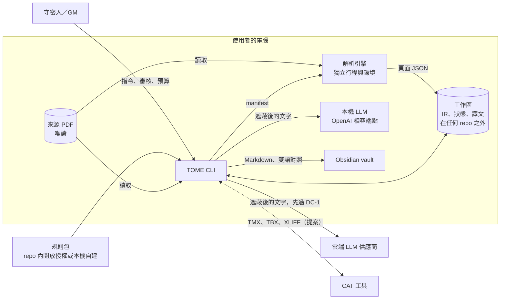
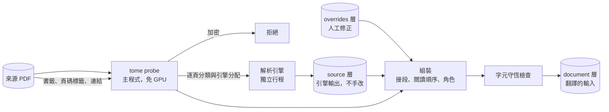

# TOME 架構白皮書

**TRPG Omnilingual Markdown Engine：把你自己擁有的 TRPG 書在本機解析，用你自己的 LLM 帳號翻成能直接上桌的繁體中文。**

| 文件控制 | |
| :--- | :--- |
| 版本 | 0.3.0-draft |
| 狀態 | 草稿。第 1、2 輪決策已定案（[§9.1](#91-已定案)），其餘章節討論中，還沒有任何程式碼 |
| 日期 | 2026-10-31 |
| 結構 | [arc42](https://arc42.org) 範本加 [C4](https://c4model.com) 視圖 |
| 正式語言 | 繁體中文（D-3）。README 另有英文版 |
| 決策紀錄 | 目前由 [§9](#9-架構決策) 追蹤；`docs/adr/`（MADR 格式）在第 8 輪建立並回填 |
| 佐證資料 | [docs/research/2026-10-31-landscape.md](research/2026-10-31-landscape.md) |
| 需求用語 | MUST、MUST NOT、SHOULD、SHOULD NOT、MAY 全大寫時依 [BCP 14](https://www.rfc-editor.org/info/bcp14) 解讀 |
| 授權 | Apache-2.0（D-2）。規則包各自帶授權 |

## 怎麼讀這份文件

每一項關於系統的主張都帶一個成熟度標籤。沒有標籤的主張算缺陷。

| 標籤 | 意思 | 需要的佐證 |
| :--- | :--- | :--- |
| **已實作** | 程式碼裡有，並由測試或可執行斷言檢查 | 原始碼路徑加測試 |
| **已定案** | 設計已寫死在本文件或 ADR，但還沒有程式碼 | 本文件的章節或 ADR |
| **目標** | 可量測的品質目標，有量測方法，**尚未量測** | [§10](#10-品質需求) 的條目 |
| **假說** | 架構倚賴的假設，必須先驗證 | [§11](#11-風險與假說) 的條目 |
| **提案** | 討論中的設計，尚未定案（只在草稿階段使用） | [§9](#9-架構決策) 的待決事項 |

**這份文件裡沒有任何實測數字。** 成本都是依公開價目推算，價目查證日是 2026-10-31。

## 目錄

- [執行摘要](#執行摘要)
- [1. 介紹與目標](#1-介紹與目標)
- [2. 限制](#2-限制)
- [3. 系統脈絡與範圍](#3-系統脈絡與範圍)
- [4. 解法策略](#4-解法策略)
- [5. 建構區塊視圖](#5-建構區塊視圖)
- [6. 執行期視圖](#6-執行期視圖)
- [7. 部署視圖](#7-部署視圖)
- [8. 橫切概念](#8-橫切概念)
- [9. 架構決策](#9-架構決策)
- [10. 品質需求](#10-品質需求)
- [11. 風險與假說](#11-風險與假說)
- [12. 詞彙表](#12-詞彙表)
- [附錄 A：成本模型](#附錄-a成本模型)
- [附錄 B：討論順序與路線圖](#附錄-b討論順序與路線圖)

---

## 執行摘要

（全部章節定案後才寫。）

---

## 1. 介紹與目標

### 1.1 問題

TRPG 書的翻譯跟一般 PDF 翻譯不一樣，難處有六個：

1. **排版就是內容**：雙欄、邊欄、表格、數值塊。一般抽取會打亂閱讀順序，表格一散，規則就不能用了。
2. **數字就是規則**：`1D100`、`1/1D6`、`[CD]`。LLM 改動一個字元，譯文看起來沒問題，規則卻錯了。
3. **譯名要全書一致**：同一個 NPC、同一條規則在四百頁裡只能有一個名字。分塊並行翻譯時，譯名最容易分裂。
4. **指代靠上下文**：日文常省略主語，英文的 they 看不出性別；中文卻要選他、她、牠、它、祂。神祇用「祂」就是一例。
5. **內容偏恐怖與暴力**：供應商的內容過濾會把正常的恐怖題材擋下來，Batch 裡甚至會以「成功」的狀態回傳拒答。
6. **書是買來的**：檔案帶著購買者個資，不能進公開 repo，也不該送給會拿內容去訓練模型的服務。

現有工具（BabelDOC、PDFMathTranslate、bilingual_book_maker、Calibre Ebook Translator）解決的是論文版面或電子書雙語。查證時沒看到針對單一遊戲系統的規則包，也沒看到能辨識數值塊的佔位保護（[佐證 §3.5](research/2026-10-31-landscape.md#35-同類工具)）。

### 1.2 目標

| ID | 目標 | 成熟度 |
| :--- | :--- | :--- |
| G-1 | **上桌品質**：譯文可直接帶團使用，骰子與數值零錯誤，譯名全書一致，用語是台灣繁體中文 | 提案 |
| G-2 | **系統與語系可插拔**：遊戲規則與來源語言都是資料或外掛，引擎核心不含任何遊戲知識。目標語言也寫成資料，但只承諾 zh-TW（D-9） | 提案 |
| G-3 | **先知道花多少，再花錢**：開跑前估價，試翻一章，超過預算就停 | 提案 |
| G-4 | **隨時可中斷**：任何步驟中斷都能續跑，已通過驗證的段落絕不重付 | 提案 |
| G-5 | **合規是結構，不是紀律**：公開 repo 在架構上就裝不進商業書籍內容與個資 | 提案 |
| G-6 | **不綁供應商**：能換供應商與模型，也能全程本機執行 | 提案 |

### 1.3 非目標

* 不散布譯文，不提供任何書籍內容。
* 不繞過 DRM，不處理加密的 PDF。
* 不產出「乾淨版」PDF，來源檔永遠不修改。
* 不把 PDF 或頁面影像送到雲端。
* 不做線上服務。TOME 是在使用者自己電腦上執行的 CLI。
* 第一版不做重新排版。輸出是結構化文字，不是印刷成品。

### 1.4 使用者與貢獻者

| 角色 | 需要什麼 |
| :--- | :--- |
| 守密人／GM | 擁有原書，想要一份能帶團的中文版 |
| 規則包作者 | 不用懂引擎內部，用資料檔就能描述一套系統 |
| 引擎貢獻者 | 測試不需要任何商業書籍就能完整跑過 |

---

## 2. 限制

### 2.1 技術限制

| ID | 限制 | 依據 |
| :--- | :--- | :--- |
| TC-1 | 參考機器：Windows 11、Ryzen 7 7735HS（8C/16T）、32 GB RAM、RTX 4060 Laptop 8 GB VRAM。沒有可用的 WSL 發行版。工具鏈是 Python 3.13 與 uv | 2026-10-31 本機探測 |
| TC-2 | PDF 與頁面影像 MUST NOT 離開本機 | 需求 |
| TC-3 | vLLM 不支援原生 Windows，所以本機 LLM 的參考 runtime 是 llama.cpp `llama-server`，其餘 OpenAI 相容端點比照 | [佐證 §1.8](research/2026-10-31-landscape.md#18-本機推論rtx-4060-laptop-8-gb) |
| TC-4 | 本機模型實際上限約 7 GB 檔案大小，且與 GPU 版面模型搶 VRAM，兩者 SHOULD NOT 同時載入 | 同上 |
| TC-5 | 各家 token 數不可比較，切塊 MUST 用與供應商無關的計量，換供應商時段落 ID 才穩定 | [佐證 §1.1](research/2026-10-31-landscape.md#11-模型與價格) |

### 2.2 授權限制

| ID | 限制 | 依據 |
| :--- | :--- | :--- |
| LC-1 | 主程式在同一行程內的相依 MUST 限 MIT、Apache-2.0、BSD、MPL-2.0 | [佐證 §2.5](research/2026-10-31-landscape.md#25-授權陷阱) |
| LC-2 | AGPL、GPL、非商業、OpenRAIL 類引擎 MUST NOT 在主程式行程內匯入，也不隨附；只能由使用者自行安裝，以獨立行程溝通 | 同上 |
| LC-3 | 引擎的程式授權與權重授權分開審查。權重授權要留下紀錄，因為兩者常常不同 | 同上（Marker、MinerU、NDLOCR-Lite 都是例子） |

原 prompt 指定的 PyMuPDF 是 AGPL-3.0，不符合 LC-1。預設堆疊改用 pypdfium2、pdfminer.six、Docling、RapidOCR，全部是寬鬆授權。

### 2.3 出版社與著作權

下表是公開 repo 能不能附帶該系統規則包的查證結果。全文與來源見[佐證 §3.1](research/2026-10-31-landscape.md#31-出版社政策)。

| 系統 | 開放授權 | 對公開附帶規則包的影響 |
| :--- | :--- | :--- |
| Basic Roleplaying | **有**（ORC） | 可以，要附 ORC 聲明，並避開 Reserved Material |
| GUMSHOE | **有**（SRD，CC BY 3.0） | 可以，要依格式署名；不含任何具名設定 |
| Call of Cthulhu 7e | 無 | 粉絲政策排除可下載軟體，需商業授權；「Call of Cthulhu」是註冊商標 |
| Delta Green | 無 | 指南明列不允許 AI 內容、翻譯、可執行檔；名稱使用也有限制。**四款裡衝突最大** |
| Trail of Cthulhu | 無 | GUMSHOE SRD 不涵蓋；商標未授權 |
| Achtung! Cthulhu | 未找到 | 社群計畫排除軟體，授權層排除生成式 AI 內容 |

遊戲機制與單一術語本身不受著作權保護（美國 17 USC 102(b)、台灣 §10-1），所以問題主要不在著作權，而在商標、出版社政策與彼此的關係。這是判斷，不是法律意見。D-1 已定案：公開 repo 只附開放授權的規則包。

| ID | 限制 | 成熟度 |
| :--- | :--- | :--- |
| PC-1 | 公開 repo MUST NOT 含有任何商業書籍的原文段落，包含規則包與測試資料 | 提案 |
| PC-2 | 每個測試素材 MUST 在來源清單登記授權與雜湊值，未登記的檔案讓 CI 失敗 | 提案 |
| PC-3 | 偵測到加密的 PDF 時 MUST 拒絕處理（台灣 §80-2、17 USC 1201） | 提案 |
| PC-4 | 來源 PDF MUST NOT 被修改，TOME 不輸出修改過的 PDF | 提案 |
| PC-5 | 文件 MUST 說明 TOME 是給使用者處理自己擁有的書，譯文不得散布 | 提案 |
| PC-6 | 公開 repo 的規則包 MUST 只含開放授權內容；品牌系統的規則包 MUST 留在使用者本機工作區，不進 repo | 已定案（D-1） |

**浮水印的立場**。原 prompt 把「浮水印剝離」列為功能，這個說法要改。台灣著作權法 §80-1 禁止移除權利管理電子資訊，§96-1 有刑責，定義又包含足以確認「其授權之人」的資訊，購買者姓名是否屬於這個定義，查不到見解。美國 1202(c) 則明文排除使用者的個人識別資訊。所以 TOME 的做法是：

* 這個功能的定位是**個資遮蔽**，目的是不讓使用者的個資外流給 LLM 或進入輸出，不是去除版權保護。
* 來源 PDF 原封不動（PC-4），遮蔽只發生在送出網路之前的衍生文字。
* 書名、作者、版權頁等權利資訊保留在輸出的來源紀錄裡。
* 文件與 CLI 都不使用「去浮水印」的說法。

### 2.4 資料外送

| ID | 限制 | 依據 |
| :--- | :--- | :--- |
| DC-1 | 任何文字送出網路前 MUST 通過個資檢查閘門，比對使用者本機設定的姓名、Email、訂單號清單，命中就停 | 需求 |
| DC-2 | 條款允許拿內容訓練的端點（Gemini 免費層、DeepSeek）MUST 預設拒絕，使用者要逐專案明確開啟 | [佐證 §1.5](research/2026-10-31-landscape.md#15-資料使用) |
| DC-3 | 估價輸出 SHOULD 同時顯示資料保留期。Batch 在 Anthropic 保留 29 天、OpenAI 30 天，都不適用 ZDR | [佐證 §1.4](research/2026-10-31-landscape.md#14-batch-api) |

### 2.5 命名

| 項目 | 名稱 | 原因 | 成熟度 |
| :--- | :--- | :--- | :--- |
| PyPI 發佈名 | `tome-trpg` | `tome` 已被占用 | 已定案 |
| Python 套件名 | `tome_trpg` | JFrog 的 `tomescripts` 會安裝頂層套件 `tome`，同環境會衝突 | 已定案 |
| 指令 | `tome`，另設別名 `tome-trpg` | JFrog 與 `@tomehq/cli` 都用 `tome`；有衝突時用別名 | 已定案 |

---

## 3. 系統脈絡與範圍

### 3.1 系統脈絡（C4 第 1 層）



信任邊界只有一條：**本機與網路之間**。跨過這條線的只有通過個資閘門（DC-1）且完成遮蔽的文字，PDF 與頁面影像不會過線（TC-2）。

### 3.2 外部介面

| 介面 | 方向 | 交換內容 | 約束 | 成熟度 |
| :--- | :--- | :--- | :--- | :--- |
| 來源 PDF | 讀入 | 使用者自己擁有的檔案 | 不修改（PC-4），加密就拒絕（PC-3） | 已定案 |
| 解析引擎 | 子行程 | manifest 與頁面 JSON（[§5.3](#53-解析引擎協定)） | 執行時離線 | 已定案（D-7） |
| 工作區 | 讀寫 | IR、狀態、本機規則包、譯文 | MUST 在任何 repo 之外，預設位置第 8 輪定 | 提案（G-5） |
| 雲端 LLM | 送出、接收 | 遮蔽後的文字 | DC-1、DC-2、DC-3 | 第 4 輪 |
| 本機 LLM | 送出、接收 | 同上 | 參考 runtime 是 `llama-server`（TC-3） | 第 4 輪 |
| Obsidian vault | 輸出 | [§5.5](#55-輸出obsidian-vault) 的目錄結構 | 譯文不得散布（PC-5） | 已定案（D-5） |
| CAT 工具 | 匯入、匯出 | TMX、TBX、XLIFF | 第 3 輪決定是否納入 | 提案 |

### 3.3 範圍

本表整理自 [§1.2](#12-目標) 與 [§1.3](#13-非目標)，成熟度依各條目。

| 在範圍內 | 不在範圍內 |
| :--- | :--- |
| 解析 PDF、產生 IR、人工修正解析結果 | 修改來源 PDF、輸出 PDF |
| 翻譯、驗證、估價、續跑 | 代管服務、帳號、譯文分享 |
| Obsidian 相容 Markdown 與雙語對照 | 重新排版成印刷成品 |
| 規則包與語言設定檔的載入 | 隨附任何商業書籍的內容 |

---

## 4. 解法策略

以下是相對於初版 prompt 的調整。S-1、S-2、S-12、S-13、S-14 已定案（D-1、D-7），其餘都是**提案**，要逐輪討論。

| ID | 策略 | 為什麼 | 輪次 |
| :--- | :--- | :--- | :--- |
| S-1 | **文件中介格式（Document IR）才是真實來源**。每個區塊有穩定 ID、頁碼、座標、角色、語言與出處；Markdown 只是輸出之一。已定案（D-7） | Markdown 會丟失座標與區塊角色，之後要接 VTT、雙語對照、重新排版時都得重抽 | 2 |
| S-2 | **解析引擎是獨立行程的外掛**，各自有環境，以 JSON 溝通。已定案（D-7） | 兩個獨立理由指向同一個設計：授權隔離（LC-2）與相依互斥（pillow、pypdfium2 裝不進同一環境） | 2 |
| S-3 | **先遮蔽，再翻譯，翻完再驗證**。骰子、頁碼參照、公式先換成佔位符，譯文回來再還原 | 原 prompt 只做事後檢查，發現錯誤還要重付一次。遮蔽讓 LLM 根本碰不到這些字元；事後檢查留著當保險 | 3 |
| S-4 | **用文字標籤協定傳段落**（如 `<s id="12">`），不用 JSON schema | 所有供應商與本機模型通用；DeepSeek 不支援 schema；Anthropic 改 schema 會讓快取失效，拒答也可能不符 schema；中文引號也不用處理跳脫 | 3 |
| S-5 | **Pass 0 產出實體卡，不只是詞表**：譯名、性別、代名詞、語域、首次出現位置，再由人審核鎖定 | 解決 §1.1 第 4 點，日文來源尤其需要 | 3 |
| S-6 | **段落層級的翻譯記憶**，快取鍵只含該段實際命中的詞彙，不是整份詞庫 | 原設計以 `Glossary_Hash` 當鍵，改一個詞就讓全書失效 | 3 |
| S-7 | **只做三種連線協定**：Anthropic Messages、Gemini、OpenAI 相容（OpenRouter、DeepSeek、本機都走這條）。不用 LiteLLM | 差異化功能（Batch、顯式快取）正好是抽象層會漏的地方；LiteLLM 2026-03 又發生供應鏈事件 | 4 |
| S-8 | **省錢順序是模型 > Batch > 快取**，快取策略由估價器依實測命中率決定，不為了跨門檻灌水 | [附錄 A](#附錄-a成本模型)：輸出費約占八成；快取命中率低於約 51% 時，開 1 小時快取反而比不開貴 | 4 |
| S-9 | **拒答是一等狀態**：獨立於 QA 失敗，可設定回退到另一個供應商 | Anthropic Batch 的拒答回傳 `succeeded`，不主動檢查就會把空結果當成功 | 4 |
| S-10 | **QA 加入術語與用語檢查**：命中的詞彙在譯文裡必須是鎖定譯名；用語檢查表抓中國大陸用語 | 原設計只有骰子、結構、長度三項，而術語一致才是 TRPG 翻譯最常出錯的地方；這些檢查都不花 token | 7 |
| S-11 | **合成 PDF 鍛造**：用程式產生帶標準答案的雙欄、邊欄、直書、假名標音 PDF | 同時解決「不能放商業書測試」與「沒有日文直書的公開評測」兩個問題 | 7 |
| S-12 | **公開 repo 只放開放授權的規則包**，品牌系統走使用者本機規則包 | [§2.3](#23-出版社與著作權)，已定案（D-1） | 1 |
| S-13 | **先用 PDF 自帶的結構，再用模型**。書籤、頁碼標籤、連結註記、tagged 結構都先讀。已定案（D-7） | 不用 GPU，可靠度也高。Docling 文件只提到用書籤推標題層級，且預設關閉；印刷頁碼對應與「見 p.123」的連結都要靠這些資料 | 2 |
| S-14 | **字元守恆檢查**。原生文字層的每個字元都要落在某個區塊，或被標成頁面雜訊，否則該頁失敗。已定案（D-7） | 不花 token 就能抓到引擎漏掉的邊欄；判斷解析品質不必等人工審閱 | 2 |

---

## 5. 建構區塊視圖

本章目前涵蓋文件模型與解析（第 2 輪）。翻譯核心與 System Pack 規格在第 3、5 輪補上。區塊角色、欄位與協定格式的**細節是提案**，第一個垂直切片實作時可以調整，但原則已定案（D-5、D-7、D-8、D-9）。

### 5.1 解析流程



`tome probe` 用 pypdfium2 在主程式內執行，不載入模型。它輸出：

* 文件層級：是否加密、是否 tagged、書籤、頁碼標籤、連結註記、是否為跨頁攤開版型。
* 頁面層級：`native`、`scan`、`broken_text`、`image_only` 四類，以及該頁要交給哪個引擎。

文件允許混用引擎，每頁都記錄來源引擎。第一個切片（D-4）只處理 `native` 頁，其他類別列入報告，不靜默跳過。

### 5.2 Document IR

格式名稱是 `tome-ir/1`，有版本號與公開的 JSON Schema，並可遷移。IR 只存在工作區，不進 repo，因為它含有書籍內容（PC-1）。

**三層**

| 層 | 內容 | 規則 |
| :--- | :--- | :--- |
| `source` | 引擎輸出的頁面，依 PDF 雜湊、引擎、版本、設定雜湊存放 | 不可變。相同的鍵不重跑 |
| `overrides` | 人工修正：改角色、改順序、合併、拆分、略過 | 獨立檔案，重新解析後還在。對不到區塊的修正要回報，不能靜默丟棄 |
| `document` | 合併後的結果：閱讀順序、區塊角色、章節樹 | 可隨時由前兩層重建，是翻譯唯一的輸入 |

**識別**

| 名稱 | 組成 | 用途 |
| :--- | :--- | :--- |
| `block_id` | 起始頁碼＋內容雜湊前綴，同頁重複時加序號，如 `p0123-3f9a1c` | 指向書裡的位置，也是 `overrides` 的鍵 |
| `content_hash` | 正規化文字的 SHA-256，與頁碼無關 | 翻譯記憶看內容，換引擎後文字沒變就不重付（G-4） |

`block_id` 不用流水號。閱讀順序一改，流水號會全部位移，`overrides` 就對不到了。順序另外存在 `document` 層。ID 只用拉丁字母、數字與連字號，可以直接當 Obsidian 的區塊識別碼。

**翻譯單位**是段落（D-8）：一個段落、清單項、標題或表格儲存格各是一個單位。第 3、4 輪再把單位組成送給 LLM 的批次。代價是勘誤只改一句時要重翻整段，雙語對照也只對齊到段。

**區塊欄位**

| 欄位 | 意義 |
| :--- | :--- |
| `id`、`content_hash` | 見上 |
| `role` | 區塊角色，見下表 |
| `flow` | `main` 或 `aside`。邊欄走 `aside`，不打斷正文，跨過邊欄的段落仍要接起來 |
| `group` | 同一個邊欄或數值塊裡的多個區塊 |
| `section` | 所屬章節路徑 |
| `spans` | 一筆以上的頁碼與座標，段落跨欄或跨頁時會有多筆 |
| `text`、`raw` | 正規化後與引擎原始的文字。`raw` 給字元守恆檢查與追查問題使用 |
| `runs` | 行內樣式與標記：粗體、斜體、小型大寫、`ruby`、連結目標 |
| `table` | 表格的列、欄、跨列跨欄與表頭，每格都是翻譯單位 |
| `lang`、`writing_mode` | BCP 47 語言標籤；`horizontal-tb` 或 `vertical-rl` |
| `provenance` | 引擎、版本、設定雜湊、信心值 |

文件層級另存 `page_map`：實體頁索引對印刷頁碼。兩者常常不同，而規則書裡的「見 p.123」寫的是印刷頁碼。

**核心角色**：`title`、`heading`、`paragraph`、`list_item`、`table`、`sidebar`、`stat_block`、`handout`、`figure`、`caption`、`footnote`、`toc`、`index`、`credits`、`furniture`。`furniture` 是頁首、頁尾、頁碼與購買者資訊。規則包可以加上帶命名空間的角色（第 5 輪），引擎核心不認得它們也要能原樣傳遞。

`lang`、`writing_mode`、`ruby` 在第一版就留好。第一個切片只用英文，日文進來時不必改格式。

`DoclingDocument` 不適合直接當 IR：它沒有邊欄或方框文字的標籤，`TextItem` 的成員也沒列字型與字級，而角色判斷正需要這些資訊（[佐證 §2.6](research/2026-10-31-landscape.md#26-docling-文件模型與-pdf-自帶結構)）。Docling 是 `tome-ir` 的輸入之一，由轉接器轉換。

**字元守恆檢查**（S-14）在 `document` 層產生前執行：拿 pdfium 的原生文字層比對 `raw`，容許空白、連字與斷字差異。缺字超過門檻，該頁標成解析失敗，不進翻譯。門檻與假陽性見 H-8。頁面是掃描件時沒有文字層，這項檢查不適用。

### 5.3 解析引擎協定

引擎是外部指令，協定名稱 `tome-engine/1`。

| 面向 | 規格 |
| :--- | :--- |
| 輸入 | 一個 JSON manifest：PDF 路徑、頁碼清單、輸出目錄、來源語言、引擎選項 |
| 輸出 | 每頁一個 `tome-ir/1` JSON；一份 `engine.json` 記錄名稱、版本、程式授權、權重授權、設定雜湊（LC-3） |
| 進度 | stdout 是 JSONL 事件，stderr 是記錄 |
| 失敗 | 單頁失敗不中止整批，結果列在輸出裡，由 TOME 決定重試或換引擎 |
| 環境 | 每個引擎一個 uv 環境與鎖定檔，由 `tome engine add` 建立，放在工作區 |
| 權重 | 只在 `tome engine add` 時下載。執行時 MUST 離線 |
| 授權 | 主程式 MUST NOT 依賴任何引擎套件。不符合 LC-1 的引擎由使用者自行安裝（LC-2） |

Docling 是預設引擎，走同一套協定，沒有特權。它能配合的地方都查過：`convert()` 有 `page_range`，權重可用 `docling-tools models download` 預先下載，再以 `artifacts_path` 指定，遠端服務預設關閉。

**已知限制**：第一版沒有網路沙箱，「執行時離線」靠的是協定、環境變數與引擎審查，TOME 無法在技術上擋住惡意引擎。第一方引擎之外的引擎，使用者要自己判斷能不能信任。

### 5.4 語言設定檔

來源語言與目標語言都是資料檔，引擎核心 MUST NOT 依語言代碼分支。

| 設定檔 | 內容 | 第一版 |
| :--- | :--- | :--- |
| 來源 | 正規化、斷字還原、接段規則、直書與標音處理、Pass 0 提示 | `en`；`ja` 等語言之後加入 |
| 目標 | 標點規則、用語檢查表、代名詞集合（他、她、牠、它、祂）、風格指南 | 只有 `zh-TW`（D-9） |

目標語言只測試與承諾 zh-TW。評測與 QA 的成本會隨語言數相乘，所以 G-2 的目標語言部分只保證「加語言時不必改架構」。

### 5.5 輸出：Obsidian vault

主要輸出是 Obsidian 相容的 Markdown（D-5），雙語對照檔一律另外輸出，給校對使用。VTT 等其他格式之後由 IR 轉出。

```text
<書名>/
├── 00-書目與來源.md    # 書名、作者、版權資訊、來源雜湊、不得散布的聲明（PC-5）
├── 01-<章名>.md        # 一章一檔
├── entities/           # 實體卡，連結的目標（第 3 輪）
├── assets/             # 從原書抽出的圖片
└── review/             # 雙語對照
```

| 來源 | Markdown 寫法 | 說明 |
| :--- | :--- | :--- |
| 章節資訊 | YAML frontmatter | Obsidian 不支援巢狀屬性，所以用扁平欄位 |
| 邊欄 | `> [!sidebar] 標題` | 未知類型會退回 `note`，所以自訂類型是安全的 |
| 數值塊 | `> [!stat-block] 名稱` | 同上，內部用表格 |
| 「見 p.123」 | `[[03-技能#閃避\|p.123]]` | 優先連到標題，連不到標題才連區塊 |
| 區塊回溯 | `^p0123-3f9a1c` | 只放在連結目標上，完整對應表放在 `review/` |

Obsidian 的限制要在輸出端處理：

* 區塊參照是 Obsidian 專屬語法，其他 Markdown 工具不支援，所以連結優先用標題。
* 連結目標含有 `#`、`|`、`^`、`:`、`%%`、`[[`、`]]` 時可能失效，檔名與連結 MUST 先清理。
* Obsidian 不支援連到引言、callout、表格的內部，所以「連到邊欄裡某一段」只能落在整個邊欄。

## 6. 執行期視圖

（第 6 輪討論。完整資料流與狀態機，含 `REFUSED`、`FAILED_QA` 等狀態。）

## 7. 部署視圖

（第 8 輪討論。安裝方式、工作區位置、CI、發佈。）

## 8. 橫切概念

（第 3、4、7 輪討論。遮蔽與驗證、快取與成本、可重現性、測試。）

---

## 9. 架構決策

### 9.1 已定案

| ID | 決策 | 理由 | 日期 |
| :--- | :--- | :--- | :--- |
| D-1 | 公開 repo 只附 `generic`、`brp-orc`、`gumshoe-srd`。Call of Cthulhu、Delta Green、Trail of Cthulhu、Achtung! Cthulhu 走本機規則包，由 `tome system init` 從使用者自己的書產生 | [§2.3](#23-出版社與著作權)：這四套沒有涵蓋軟體的開放授權，Delta Green 的指南還明列不允許 AI 內容與翻譯 | 2026-10-31 |
| D-2 | 專案授權 Apache-2.0，規則包各自帶授權，署名放 `NOTICE` | 有專利條款；`NOTICE` 正好用來放 ORC 與 CC BY 的署名 | 2026-10-31 |
| D-3 | 白皮書以繁體中文為準，README 另有英文版 | 使用者主要是繁中玩家 | 2026-10-31 |
| D-4 | 第一個垂直切片：英文、原生文字層 PDF → zh-TW，BRP ORC 文件當公開測試素材 | 風險最低，能最快驗證翻譯核心；日文直書與假名標音排到後面 | 2026-10-31 |
| D-5 | 主要輸出是 Obsidian 相容的 Markdown，保留區塊 ID；雙語對照檔一律另外輸出；VTT 等其他格式之後由 IR 轉出 | 帶團時要快速搜尋與跳轉；一般 Markdown 工具也讀得動 | 2026-10-31 |
| D-6 | 命名依 [§2.5](#25-命名) | 避開 PyPI 與 Python 套件衝突 | 2026-10-31 |
| D-7 | IR 用自訂的 `tome-ir`，分 `source`、`overrides`、`document` 三層；`block_id` 與 `content_hash` 分開；Docling 是預設引擎，以獨立行程外掛執行；先用 PDF 自帶結構；每頁做字元守恆檢查 | [§5.2](#52-document-ir)、[§5.3](#53-解析引擎協定)：`DoclingDocument` 放不下 TRPG 角色；換引擎與重新解析時，已付費的譯文與人工修正都要留得住 | 2026-10-31 |
| D-8 | 翻譯單位是段落，不是句子 | LLM 要看到整段才解得開指代，中文也需要併句、調語序。接受勘誤重翻整段與雙語只對齊到段的代價 | 2026-10-31 |
| D-9 | 目標語言規則放資料檔，只測試與承諾 zh-TW | 加語言時不必改架構，也不讓 QA 與評測隨語言數相乘 | 2026-10-31 |

### 9.2 待決

| ID | 決策 | 建議 | 輪次 |
| :--- | :--- | :--- | :--- |
| D-10 | 圖片裡的文字（地圖、手寫信件等 handouts）要不要翻 | 第一版不翻，保留原圖，列在報告裡 | 3 |
| D-11 | 索引、目錄、版權頁要不要翻 | 索引預設不翻，因為 Markdown 沒有頁碼，靠搜尋取代；目錄由標題重新產生；版權頁保留原文，放進來源紀錄 | 3 |

---

## 10. 品質需求

（第 7 輪討論。每項目標都要有量測方法。）

---

## 11. 風險與假說

| ID | 假說 | 為什麼重要 | 怎麼驗證 |
| :--- | :--- | :--- | :--- |
| H-1 | Anthropic Batch 搭 1 小時快取與同步預熱，命中率能穩定超過 51% | 低於這條線，開快取比不開貴 | 用公開素材各跑一批，讀 `usage` |
| H-2 | 便宜模型（Haiku 5.5、gpt-6-luna、Flash-Lite）的 zh-TW 品質足以上桌 | 模型選擇是最大的成本槓桿，差距達百倍 | 同一段素材跨模型盲評 |
| H-3 | 本機 8 GB 模型做得到 Pass 0，甚至主翻譯 | 決定能否全程本機 | 同 H-2；實體抽取另算召回率 |
| H-4 | 恐怖題材的拒答率低到可以用回退處理 | 決定是否需要多供應商才能跑完一本書 | 用公有領域的 Lovecraft 文本測各家拒答率 |
| H-5 | Docling 加自製規則處得好雙欄、邊欄、數值塊 | 解析錯了，翻譯再好也沒用 | 合成 PDF 鍛造 + 本機私有語料 |
| H-6 | 字級與位移規則足以處理原生日文 PDF 的假名標音 | 沒有現成函式庫 | 合成 PDF 鍛造 |
| H-7 | 目標書籍多半帶書籤與頁碼標籤 | 沒有的話，章節層級與印刷頁碼要改從版面推斷，「見 p.123」的連結會變差 | 本機私有語料統計；`tome probe` 回報覆蓋率 |
| H-8 | 字元守恆檢查的假陽性夠低，不會把好頁面擋下來 | 隱藏文字、可選內容圖層、疊印的重複文字都可能造成差異 | 合成 PDF 鍛造 + 本機私有語料，再決定門檻 |
| H-9 | 內容雜湊夠穩定，換引擎後翻譯記憶仍命中 | 引擎對空白、連字、斷字的處理不同，正規化不夠就白付一次 | 同一份公開素材用兩個引擎解析，比對 `content_hash` 重合率 |

---

## 12. 詞彙表

隨討論補齊。

| 詞 | 意思 |
| :--- | :--- |
| Document IR、`tome-ir` | TOME 的文件中介格式，翻譯與輸出都以它為準 |
| 區塊 | IR 的基本單元，如一個段落、標題或表格 |
| 翻譯單位 | 翻譯與翻譯記憶的最小單元：段落、清單項、標題或表格儲存格（D-8） |
| 引擎 | 把 PDF 頁面轉成 `tome-ir` 的外部指令 |
| 頁面雜訊（`furniture`） | 頁首、頁尾、頁碼、購買者資訊這類不屬於正文的內容 |
| 邊欄 | 正文流之外的方框或側欄文字 |
| 數值塊 | NPC、怪物等以固定格式列出的數值 |
| 規則包 | 描述一套遊戲系統的資料檔（第 5 輪） |
| 字元守恆 | 原生文字層的字元都要有去處的檢查（S-14） |

---

## 附錄 A：成本模型

**假設，非實測**：一本 300 頁的書，來源 250k token，切成 125 塊，每塊 2k，帶 250 token 上文；靜態前綴 8k；譯文是來源的 1.2 倍。各家 token 計法不同，這裡用同一個數字，只適合比較量級。單位是美元，價格查證日 2026-10-31。

| 模型 | 即時 | 即時＋快取 | Batch | Batch＋1h 快取（命中約 100%） | Batch＋1h 快取（命中 30%） |
| :--- | ---: | ---: | ---: | ---: | ---: |
| Fable 5.1 | 27.81 | 18.16 | 13.91 | 9.11 | 15.94 |
| Opus 5.5 | 11.12 | 7.36 | 5.56 | 3.69 | 6.39 |
| Sonnet 5.5 | 5.56 | 3.68 | 2.78 | 1.85 | 3.20 |
| Haiku 5.5 | 0.28 | 0.19 | 0.14 | 0.09 | 0.16 |

其他 Batch 或離峰價格（不計快取）：`gpt-6-luna` 0.14、`gpt-6.1-sol` 2.78、`gemini-3.5-flash-lite` 0.57。`deepseek-flash` 離峰全命中約 0.23，但受 DC-2 限制，預設不用。

三個結論：

1. **模型選擇差到百倍**，Batch 固定省 50%，快取最好再省約 34%。
2. **輸出費約占最佳情境總成本的八成**，快取碰不到這一塊。
3. **快取有損益兩平點**。Batch 的未命中要付寫入價，損益兩平命中率 = (寫入價 − 輸入價) ÷ (寫入價 − 讀取價)。Sonnet 5.5 用 1 小時 TTL 是 (2 − 1) ÷ (2 − 0.05) ≈ 51%。Anthropic 文件列的觀測範圍是 30–98%，所以這不能假設，要量（H-1）。

Gemini 顯式快取也算過：Flash-Lite 上 8k 前綴省下約 0.13，但排隊 24 小時的儲存費約 0.19，不划算。預設走隱式快取。

---

## 附錄 B：討論順序與路線圖

| 輪次 | 主題 | 章節 |
| :--- | :--- | :--- |
| 1 | 定位與邊界：範圍、規則包、授權、語言（決策 2026-10-31 定案） | §1、§2、§9.1 |
| 2 | 文件模型與解析：IR、解析外掛、語系處理、輸出用途（決策 2026-10-31 定案） | §3、§5 |
| 3 | 翻譯核心：遮蔽、段落協定、實體卡、翻譯記憶 | §5、§8 |
| 4 | 供應商與成本：連線協定、快取與 Batch 策略、估價器、資料閘門 | §5、§8 |
| 5 | System Pack 規格與 `tome system init` | §5 |
| 6 | 狀態機、SQLite 結構、CLI 指令樹 | §6 |
| 7 | QA、評測、測試策略 | §8、§10 |
| 8 | Repo 治理、CI/CD、發佈 | §7 |
| 9 | 路線圖、`CLAUDE.md`、讀者測試（用無上下文的新工作階段驗證文件） | 全部 |
